# reSystem Investment | Admin guide

Version 1.1 | 23 October 2026 | Client UAT edition

For project administrators, finance operators, support staff and client testers. Open the admin panel at **https://admin.resystem.org**. The features visible to you depend on your assigned permissions.

<!-- VISUAL WALKTHROUGH START -->
## Screenshot walkthrough
Use these screenshots with the numbered steps. The PDF enlarges the relevant panels and overlays matching markers. Screens are actual INFRA UAT captures dated 23 October 2026, except the explicitly labelled archived publication review. Balances, addresses, sample values and expired reviews are examples, not instructions to copy.

### Visual 01. Sign in with your own staff account
Open: **admin.resystem.org/sign-in**
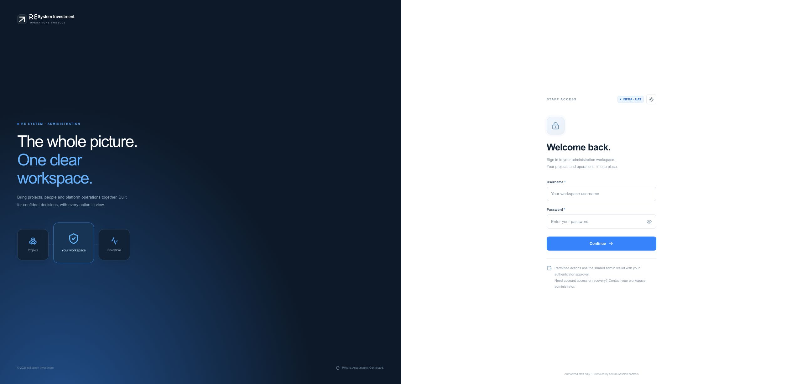
1. **Enter your credentials.** Use your individual username and password, then select Continue.
2. **Complete the security step.** Follow enrollment if this is your first login. Enter the current authenticator code yourself.
3. **Check your workspace.** Confirm the intended account and INFRA UAT environment before working.
**Remember:** No personal wallet connection is needed. Never share passwords, setup keys or authenticator codes.
Screenshot: 23 October 2026.

### Visual 02. Start with the platform overview
Open: **Overview**
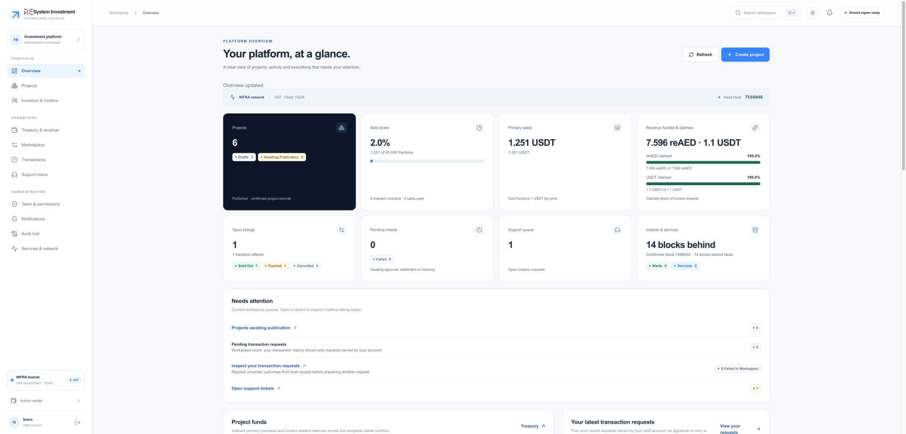
1. **Check platform health.** Read service and indexer status before interpreting the numbers.
2. **Read the right balance.** Primary proceeds, revenue funding and reward claims are different records.
3. **Choose your next area.** Use the left navigation for Projects, Treasury & revenue and Transactions. Detailed histories are available below the overview.
**Remember:** These are dated UAT examples. Unavailable or delayed data is not the same as a zero balance.
Screenshot: 23 October 2026.

### Visual 03. Find or create a project
Open: **Projects**
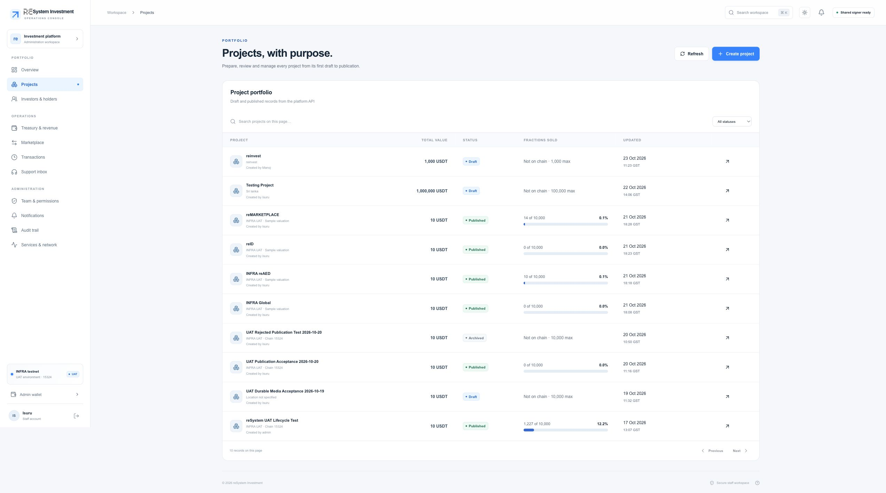
1. **Find the named project.** Search the list and check its draft/published state before opening it.
2. **Open the project.** Use its name to inspect content, economics, media and lifecycle.
3. **Start a new draft.** Choose Create project only when you have approved content and economics.
**Remember:** A draft is an internal record. Publication and opening the sale are later, separate actions.
Screenshot: 23 October 2026.

### Visual 04. Draft step 1: describe the project
Open: **Projects > Create project > Details**
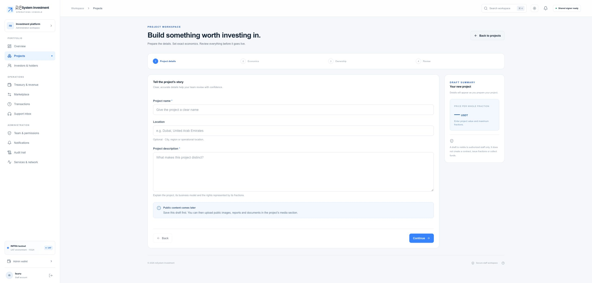
1. **Give it a clear name.** Use the name investors should recognize. Label test projects clearly.
2. **Explain the project.** Enter the description and optional location with approved public wording.
3. **Continue to economics.** Continue moves to the next step; it does not publish a project.
**Remember:** Public content must not contain passwords, confidential records or private support material.
Screenshot: 23 October 2026.

### Visual 05. Draft step 2: check the price
Open: **Create project > Economics**
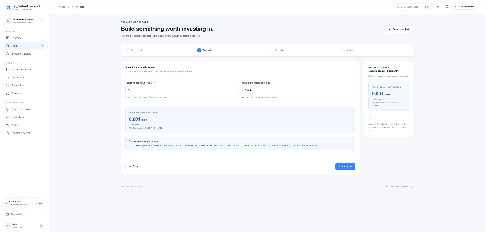
1. **Enter total value.** Enter the approved project value in USDT.
2. **Enter whole fractions.** Set the maximum fraction count. Check that the value divides exactly at supported precision.
3. **Check the calculated price.** The displayed per-share price must match the agreed economics before continuing.
**Remember:** Unsaved demonstration: 10 USDT / 10,000 fractions = 0.001 USDT each. Do not copy sample values into a real project.
Screenshot: 23 October 2026.

### Visual 06. Draft step 3: owner and treasury
Open: **Create project > Ownership**
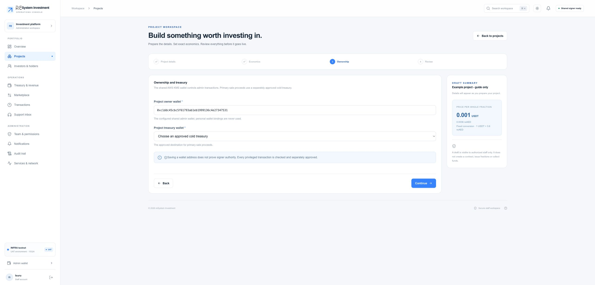
1. **Check the owner.** The configured shared admin wallet is the project owner. Staff cannot replace it with MetaMask.
2. **Choose an approved treasury.** Select the approved destination for primary-sale withdrawals.
3. **Continue after checking.** Check both destinations before continuing. The owner manages the contract; the treasury receives primary proceeds.
**Remember:** Selecting a treasury is a business decision. A destination must be approved before it appears in this list.
Screenshot: 23 October 2026.

### Visual 07. Draft step 4: review, then save
Open: **Create project > Review**
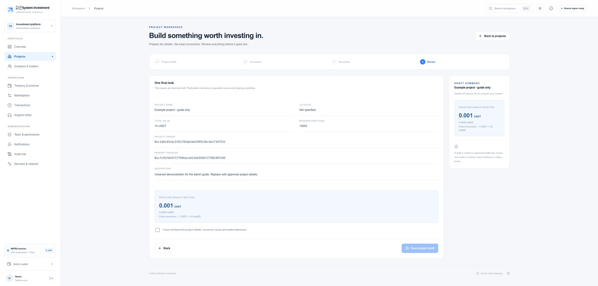
1. **Review every field.** Check the name, description, owner, treasury, total value, supply and price.
2. **Acknowledge the review.** Select the acknowledgment only after checking the information.
3. **Save the project draft.** Reopen the saved draft and add public media. Saving does not create a blockchain project.
**Remember:** This screenshot is an unsaved demonstration. No draft was created for the guide.
Screenshot: 23 October 2026.

### Visual 08. Add the project image and documents
Open: **Projects > Project > Media & metadata**
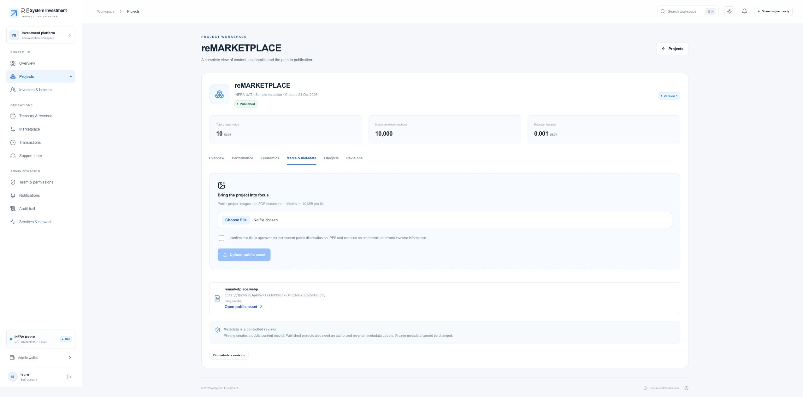
1. **Select the public file.** Choose an approved project image or public document, within the displayed 10 MiB limit.
2. **Review public permanence.** Read the acknowledgment before upload. Public project media is different from private support files.
3. **Prepare the metadata revision.** Wait for upload/pinning, then check the current revision and image before publication.
**Remember:** On a published project, applying a new metadata revision is a separate authorized transaction. Frozen metadata cannot be casually replaced.
Screenshot: 23 October 2026.

### Visual 09. Read the exact publication review
Open: **Project publication > Exact transaction review**
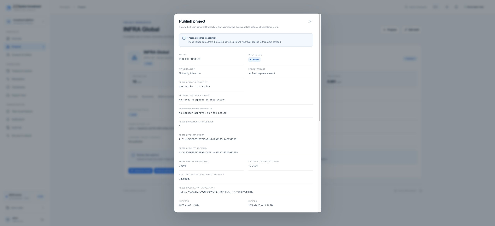
1. **Check the frozen values.** Read the owner, treasury, maximum fractions, total value and metadata. Approval applies to this exact request.
2. **Check network and expiry.** Use the intended INFRA chain and a current review. Scroll through all transaction details.
3. **Approve personally.** When the values match, acknowledge them and use a fresh code with Approve with authenticator. Track the result in Transactions.
**Remember:** Archived 21 Oct example, already expired. Never reuse these values as a live approval. A second approver may be required by policy.
Screenshot: 21 October 2026 - archived review.

### Visual 10. Open or close a primary sale
Open: **Projects > Project > Lifecycle**
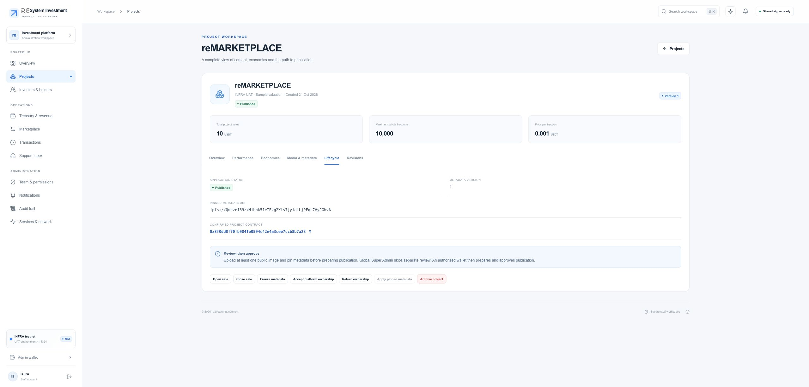
1. **Check the project state.** Open Lifecycle on the intended published project.
2. **Open the sale separately.** Use Open sale, review the exact contract/fee and approve with a fresh authenticator code.
3. **Verify before announcing.** Wait for confirmed/indexed status, then check that the investor project can be bought.
**Remember:** Closing a sale stops new primary purchases after confirmation. It does not refund investors or erase their shares.
Screenshot: 23 October 2026.

### Visual 11. Understand treasury and revenue
Open: **Treasury & revenue**
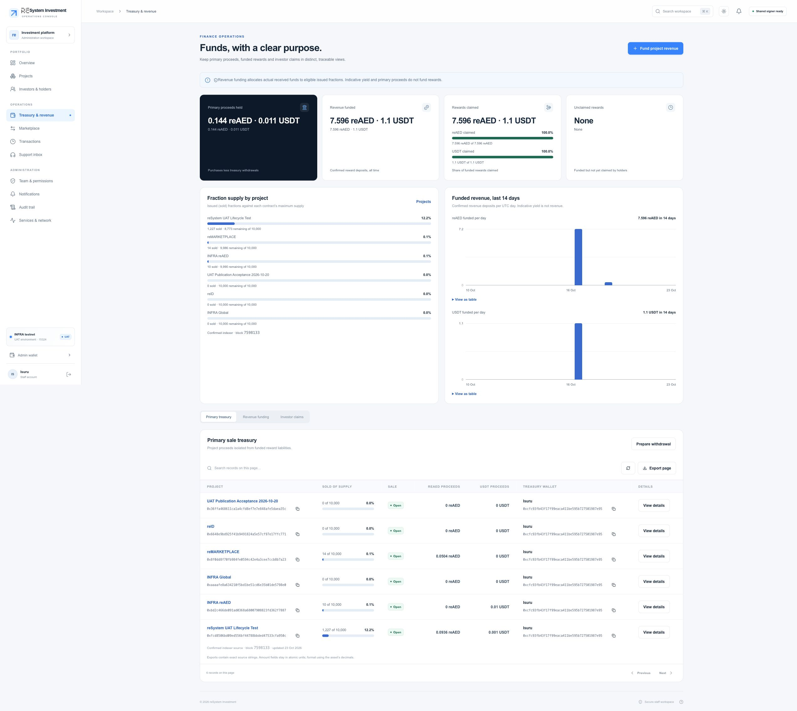
1. **Primary proceeds.** Purchase funds held for the approved treasury are separate from investor rewards.
2. **Revenue and claims.** Review actual revenue deposits and the amounts investors have claimed.
3. **Prepare approved funding.** Choose Fund project revenue for a new revenue deposit. Use the breakdown and history tabs below for existing records.
**Remember:** A yield setting does not create rewards. Only confirmed revenue funding makes assets available for claims.
Screenshot: 23 October 2026.

### Visual 12. Prepare a revenue deposit
Open: **Treasury & revenue > Fund project revenue**
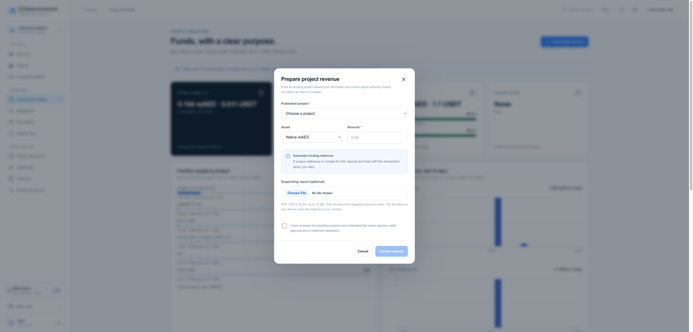
1. **Choose project, asset and amount.** Select the published project and intended deposit. The contract must have issued holders.
2. **Use the automatic reference.** The form creates the unique funding reference. Optionally select a PDF, CSV or XLSX report for a local fingerprint.
3. **Review and approve funding.** Acknowledge the purpose, then review exact values. USDT allowance, if needed, is a separate approval before funding.
**Remember:** The report file stays on your device; only its fingerprint is referenced. Keep the original. Do not repeat an uncertain deposit.
Screenshot: 23 October 2026.

### Visual 13. Follow a transaction to completion
Open: **Transactions**
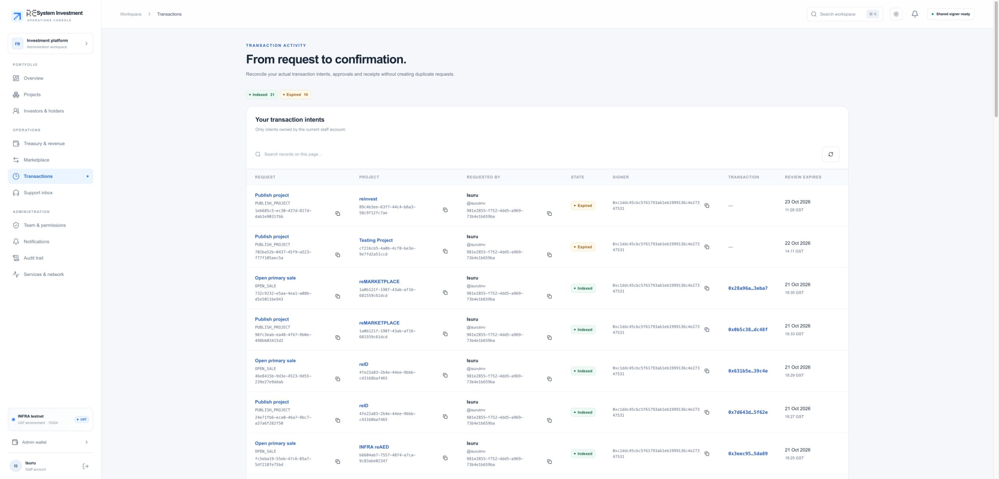
1. **Find the existing request.** Use the project, action and time to identify the request you already submitted.
2. **Read its state.** Prepared is not broadcast; confirmed is not yet the same as indexed in the app.
3. **Investigate uncertainty.** Open details and preserve the request/hash. Refresh the existing attempt before creating another one.
**Remember:** If a result is uncertain, do not repeat the transaction. An on-chain failure can still use a network fee.
Screenshot: 23 October 2026.

### Visual 14. Create separate staff access
Open: **Team & permissions > Add staff account**
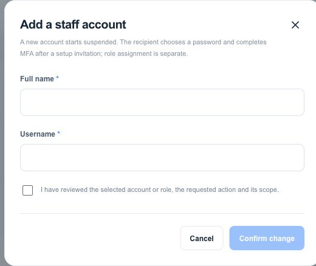
1. **Enter the staff identity.** Use the intended person's name and individual username.
2. **Confirm the intended scope.** Review the acknowledgment. Creating the account alone does not assign every permission.
3. **Complete invitation and roles.** The account starts suspended. Use the supported setup invitation and authorized role assignment; the recipient sets password and MFA.
**Remember:** Use the least access needed. Reserved super-admin grants and exceptional recovery require the protected owner/operator procedure.
Screenshot: 23 October 2026.
<!-- VISUAL WALKTHROUGH END -->

## Detailed reference
The following sections explain the rules, exceptions and troubleshooting behind the visual walkthrough.
## 1. What the admin panel does

Use the admin panel to prepare and publish investment projects, manage their sale status, fund investor rewards, review financial records, assist investors and manage authorized staff. Each administrator has a separate login. Authorized blockchain actions use one shared admin wallet; you do not connect MetaMask or another personal wallet to the admin panel.

This edition describes the stable **CLIENT-UAT-2026-10-23** version on INFRA testnet, chain 15324. The four landing projects use sample valuations for testing. Their transaction records are real UAT chain records; their valuations are not an offer of a live commercial investment.

Three distinctions prevent common mistakes:

- **Saving a draft** changes project information in the application. **Publishing** creates its on-chain project and requires approval.
- **Publishing a project** and **opening its sale** are separate actions. A published project is not automatically available to buy.
- **Primary sale proceeds** belong to the configured treasury. **Funded revenue** is reserved for investor rewards. **Resale proceeds** belong to the seller. These are separate balances.

## 2. First login and account security

1. Open the admin URL and use the individual username and password supplied privately by the platform owner. Do not use another administrator's account.
2. If prompted to set up an authenticator, scan the QR code with your authenticator app. Keep the setup key private and complete the six-digit code step yourself.
3. For later logins, enter the current authenticator code when requested. A password alone does not complete privileged login.
4. Check that the dashboard shows the intended account and environment before working.
5. Sign out when finished, especially on a shared device.

If the code fails, check that your device clock is automatic and use a current code. An expired enrollment or sign-in attempt needs a new attempt. Repeated failed attempts can be rate-limited. If the authenticator is lost, contact the authorized platform operator for recovery; do not request a bypass from another staff member or send them a code.

A permission error is different from a login failure. A person who can edit a project may not be allowed to publish it, fund it or manage staff. Ask the owner to review the required access rather than sharing a super-admin password.

## 3. Finding your way around

| Area | What you use it for |
| --- | --- |
| Overview | Check platform health, project figures and recent requests; expand detailed charts when needed |
| Projects | Create drafts, manage content/economics, review, publish and operate project contracts |
| Investors | Review authorized investor/holder/sales information with names and supporting identifiers |
| Treasury | Review primary proceeds, revenue funding and investor claims; prepare authorized finance actions |
| Marketplace | Inspect listings, fills and seller proceeds; distinguish open, filled, cancelled and expired listings |
| Transactions | Follow your transaction intents from review through confirmation/indexing; inspect exact details |
| Support | Read permitted private tickets, reply and use supported private image attachments |
| Staff | Manage accounts, roles, scope and invitations if your role permits |
| Notifications | Read operational/account updates available to your session |
| Audit | Inspect authorized action history and accountability records |
| Services | Inspect service/indexer/signer state and permitted operational controls |
| Admin wallet | View the shared signing arrangement and follow the link to its status |

Some areas or controls may be hidden or restricted for your role. Project-scoped staff only receive the permitted project context. The Overview's request history is account-scoped; do not interpret it as every administrator's activity or as a global investor total.

## 4. Reading the dashboard correctly

Use Overview at the start of a session. Check the environment, service status, indexer freshness and any blocked work. The dashboard includes published project supply/price/sale information and indexed financial records. Detailed histories may load only when you open them.

| Display | Meaning |
| --- | --- |
| Maximum fractions | The project's full configured supply |
| Issued/sold fractions | Fractions actually issued through confirmed purchases |
| Available fractions | Remaining primary-sale supply, subject to the sale still being open |
| Primary proceeds | Purchase funds held for the configured project treasury |
| Reward reserve / claim records | Deposited reward funding and its subsequent investor claims |
| Unavailable or incomplete | The source is not ready or could not be read; it is not a zero balance |
| Confirmed / indexed | Chain confirmation and the application's later recorded view are distinct steps |

Use Refresh after an operation, but allow for chain confirmation and indexer processing. If an error is shown after a successful write, inspect the existing record before repeating the write. A refresh error can mean the change was saved but the refreshed view could not be loaded.

## 5. Create a project draft

1. Open **Projects** and select the create/new-project action.
2. Enter the project name, description and any location/details requested by the form. Use wording suitable for investors. Clearly identify UAT sample projects.
3. Enter the total project value in USDT and the maximum whole-fraction count. Check the resulting per-fraction price before saving.
4. The owner is the shared admin wallet and is read-only. Select a treasury only from the approved destinations. The owner signs management actions; the treasury receives primary-sale withdrawals.
5. Save the draft and reopen it to verify the values. A draft is not yet a public investment.
6. Add the project's public image and any approved public documents. Read the upload acknowledgment. Do not include credentials, private personal records or confidential support material in public project files.
7. Prepare/pin the metadata when the project flow asks for it, then wait for processing to complete. Check the image and exact current revision before publication.

**Worked UAT example:** total value 10 USDT, 10,000 fractions, 0.001 USDT per fraction. At the platform's fixed conversion, one fraction costs 0.0036 reAED. Network fees are extra. This is an explanation of the existing sample setup, not a direction to create another project.

The value must divide into the fraction count exactly at the supported USDT precision. Fix an invalid combination in the form; do not round it to a different investment price. Avoid editing approved economics or metadata while someone is reviewing a publication transaction.

## 6. Review, publish and open the sale

### Draft review

Ordinary publishing requires an independent reviewer: the draft creator cannot supply their own independent approval. The reviewer checks the business content, economics, public media, treasury and readiness. The reserved global super-admin may publish directly under the owner's approved policy, but still completes all exact transaction and authenticator checks.

### Publication

1. Open the eligible project and its publication action.
2. Inspect the prepared review: project name, total value, fractions, metadata, chain, factory destination, shared owner, treasury, native value, fee and expiration.
3. If anything is wrong, cancel and correct the draft. Do not approve a review on the assumption that it will pick up a later edit.
4. Personally acknowledge the exact values. Enter a fresh authenticator code and select **Approve with authenticator** when that is the displayed action.
5. If a second approver is required by the current policy, wait for a different authorized person to review and approve the same request.
6. Follow the existing transaction in **Transactions**. Wait for confirmation and the project's indexed/published state. Record the transaction link for your work log.

### Opening the sale

After publication, use the project's **Open sale** action. This is a separate reviewed transaction with its own fee and fresh authenticator code. Verify the correct project contract, then wait for confirmation before telling investors it is ready to buy. Check the public project page afterward.

Closing a sale stops new primary purchases when the close action is confirmed. It is not a refund, token deletion or withdrawal of existing investor claims. Any later reopening is another separately approved action.

## 7. How the shared admin wallet works

All authorized admin contract actions use the same wallet:

`0xc1ddc45cbc5f61793ab1eb1999136c4e27347531`

Its private key is protected by AWS KMS. The application and signing service run on FP. Staff do not receive or import that private key. Every action still records who requested and approved it. A shared wallet does not mean a shared staff account.

Before approving, check:

1. **Environment:** INFRA UAT, chain 15324.
2. **Purpose:** the intended project and action.
3. **Destination:** the exact reviewed contract or approved treasury policy.
4. **Value and asset:** native payment, token amount and any limited allowance.
5. **Fee and expiry:** current estimate and time remaining.
6. **Outcome:** what changes once confirmed, and whether the operation is irreversible.

Use a fresh authenticator code for each approval. If the review expires before approval, create a fresh review. If submission may already have happened, inspect the existing transaction first; do not repeat it.

The Services page exposes signing state only to authorized staff. Enabling signing uses a request and a separate confirmation with a different fresh authenticator code. It does not itself submit a chain transaction. Do not toggle it to troubleshoot a general data-loading error. Policy, balance, current ownership and rate/amount limits can still block a particular action even when signing is enabled.

No personal wallet connection is needed in the admin panel. An unavailable shared signer must be investigated; connecting MetaMask is not a fallback.

## 8. Fund project revenue

Revenue funding makes actual assets available to reward eligible investors. Setting an advertised yield or entering a report does not create rewards. Funding requires a confirmed deposit into the project's reward pool, and the project must have issued holders.

1. Open **Treasury**, then the revenue-funding action.
2. Choose the published project. Confirm its name and contract context.
3. Choose reAED or USDT and enter the intended amount.
4. The form generates a unique funding reference automatically. You do not need to create or type a `bytes32` value.
5. Optionally select the approved supporting PDF, CSV or XLSX report when offered. The browser computes its fingerprint locally. **The report body is not uploaded by this reference field.** Keep the original in the client's approved records so the fingerprint can be checked later.
6. Acknowledge the reporting purpose and open the exact review. Check the project, asset, amount, fee and shared signer.
7. For USDT, if an allowance is required, approve only the displayed limited allowance to the project. Wait for confirmation, then separately review and approve the actual funding transaction. An allowance alone is not revenue funding.
8. Approve funding with a fresh authenticator code and wait for its confirmed/indexed record. Check the revenue entry and available reward figures.

A supporting report reference links the funding to a fingerprint, not to a publicly downloadable report. A funding reference helps distinguish deposits and reject accidental duplicate references. Preserve the existing attempt through a retry; do not repeatedly generate a new deposit after an uncertain submission.

Rewards are allocated to holders when the funding reaches the contract. A person who sold or transferred all fractions retains previously earned claims but does not earn from later deposits. The number of issued fractions, rather than unsold maximum supply, determines participation in a particular revenue allocation.

## 9. Treasury withdrawals and other project operations

Primary purchase proceeds can be withdrawn through the authorized treasury action. Read the displayed amount and destination policy. The contract pays its current configured treasury at execution; it is not a free-form payout to an address typed by staff. A treasury withdrawal is separate from investor reward claims and marketplace proceeds.

For any available project operation:

| Action | Practical effect |
| --- | --- |
| Set yield | Updates the permitted project yield information; does not create funded rewards or guarantee future returns |
| Update metadata | Changes the permitted public metadata reference after a fresh exact review |
| Freeze metadata | Locks metadata under contract rules; treat the displayed irreversible warning seriously |
| Close/open sale | Controls new primary purchases; does not erase existing ownership |
| Accept/return ownership | Changes management authority under the restricted policy; owner/operator ceremony, not a routine support fix |
| Archive a project record | Application workflow action; does not destroy its on-chain tokens or reverse settlement |

Availability depends on your role, the project's state and the signing policy. Ask the operator to investigate a blocked action; do not split a transaction into repeated calls solely to evade a configured policy limit.

## 10. Transactions, reports and reconciliation

Open **Transactions** to follow your requests. Use the named project and details to confirm you are viewing the correct operation. IDs are useful for support and audit, but project names make day-to-day work easier.

| State/message | What you should do |
| --- | --- |
| Prepared / awaiting approval | Review the exact values before expiry; no completed settlement yet |
| Awaiting second approval | Ask the designated independent approver to use their own account |
| Submitting / broadcast | Track this request; do not submit a replacement |
| Confirmed | The chain accepted the transaction; the indexed view may still be updating |
| Indexed | The application has recorded the confirmed chain effect |
| Rejected / expired before submission | No successful action is established; use a new review if still needed |
| Failed | Read the reason and any receipt; an on-chain failure may still incur a network fee |
| Reconciliation required / outcome uncertain | Give the existing intent/hash to the operator and wait; never assume nothing happened |

Use Investors, Treasury and Marketplace for the corresponding detailed records. A project can have one purchase transaction with several related event rows; row count is not always unique transaction count. CSV export controls export the filtered current page, not necessarily the entire database. Preserve raw units/asset labels when reconciling, and do not combine USDT and reAED into a single cash total without an explicit conversion basis.

A marketplace listing is not a completed sale. Confirmed fills show actual resale; seller proceeds may require a later withdrawal. The admin's reports do not let staff take over an investor's wallet or sign that investor's claim.

## 11. Support and notifications

Open a support ticket, read the context and reply from your own authorized staff account. Use the paperclip for permitted private screenshots: PNG, JPEG or WebP up to 3 MiB. Redact passwords, codes, keys and unrelated personal data before selecting a file. PDF and other document types are not supported by private support attachments.

Files remain private to the ticket's authorized parties and are downloaded through authenticated access. They do not become catalogue images. If the message saves but its attachment fails, retry the file against the saved message rather than duplicating the reply. A saved reply can appear before its attachment finishes.

Investor transaction/support email is sent according to their reID email and preferences. They do not need a second platform email-confirmation flow. An in-app notification, SMTP acceptance and receipt in the person's inbox are different facts; do not promise delivery merely because a UI action succeeded.

Use ticket status controls to keep the support queue accurate. Close the ticket only after the outcome is resolved or agreed. Retain useful transaction links and concise steps; never copy private keys or authentication material into the conversation.

## 12. Staff, roles and audit

If you have staff-management permission, create or invite each person separately. Select only the required role and scope. A project-scoped editor does not need global financial or super-admin authority. The recipient completes their own password/MFA setup.

Review access when responsibilities change. Suspension or role removal affects ongoing authorization, not past confirmed chain transactions. Use the supported account recovery process for lost access. Reserved super-admin grants and exceptional recovery require the platform owner's explicit authorization and protected operator procedure; they are not ordinary role-name changes.

Use Audit to establish who performed an operation, what it concerned and when. For an investigation, supply the relevant record/intent/transaction ID privately. Never alter historical audit or chain rows to make a report appear correct.

## 13. Troubleshooting

| Problem | Next step |
| --- | --- |
| Login/MFA rejected | Check account, current code and device time; restart expired flow; contact operator for recovery |
| A menu/action is missing | Confirm your role and project scope with the owner |
| Publication unavailable | Check required draft fields, current pinned metadata, review eligibility and signer readiness |
| Published project cannot be bought | Confirm sale is open, supply exists and investor has payment asset plus native fee |
| Revenue funding rejected | Check issued holders, amount/asset, limited USDT allowance, shared-wallet balance and policy |
| Approval expired | Prepare fresh only if the old action was not already submitted |
| Submitted action looks stuck | Inspect its existing status/hash and indexer freshness; report uncertainty before retrying |
| Dashboard is unavailable | Refresh once; check Services; preserve any saved result and report the error |
| NFT has no image in a wallet/explorer | Known external gateway/cache and collection-name limitation; verify ownership separately |

The external NFT display issue does not mean a confirmed balance is absent. Current V1 metadata/artwork is intact and application images load, but explorer/MetaMask acceptance remains with the external operator. Do not create another project or mint more tokens as a display repair.

## 14. Client test checklist and handover

Before a test round, agree on staff permissions, project, test wallets/assets and any transaction budget. A checklist is not spending authorization. Keep the shared environment stable while QA tests it.

1. Sign in with a separate staff account and complete MFA.
2. Confirm the intended menu permissions and project scope.
3. Inspect Overview, project state, finance records and freshness labels.
4. Save/reopen an authorized draft and verify its public image/content.
5. Check the automatic revenue reference and optional local report fingerprint without submitting funds unless approved.
6. Exercise an authorized review, expiry/rejection and successful transaction only within the agreed plan.
7. Confirm the transaction's receipt and resulting indexed project/finance state.
8. Test private support, notifications and current-page report export.
9. Verify sign-out and a different staff identity do not expose the first person's private state.
10. Record pass/fail and client approval separately from engineering test results.

When reporting an issue, include **CLIENT-UAT-2026-10-23**, page URL, role, browser/device, time, steps, expected result and actual message. Include a public transaction hash when relevant. Remove credentials, codes and private attachment content from screenshots. Known remaining production items include independent review, complete device/client acceptance, off-host resilience and production release approval.

This guide describes the current admin routes and the dated stable release. It does not replace the client's business approval process or grant new administrative permissions.
