# reSystem Investment | Investor guide

Version 1.1 | 23 October 2026 | Investor UAT edition

Open **https://re-system-investment-front-end.vercel.app/invest** to sign in. Browse published projects at **https://re-system-investment-front-end.vercel.app**.

<!-- VISUAL WALKTHROUGH START -->
## Screenshot walkthrough
Use these screenshots with the numbered steps. The PDF enlarges the relevant panels and overlays matching markers. Screens are actual INFRA UAT captures dated 23 October 2026, except the explicitly labelled archived publication review. Balances, addresses, sample values and expired reviews are examples, not instructions to copy.

### Visual 01. Connect your reID account
Open: **re-system-investment-front-end.vercel.app/invest**
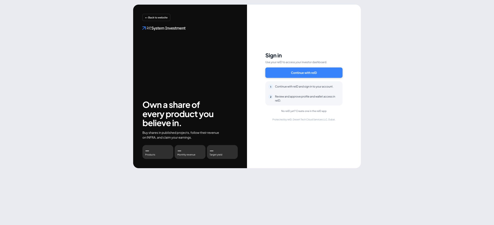
1. **Select Continue with reID.** Open the investor app and choose this button.
2. **Complete reID sign-in.** Review profile/wallet access and complete your own security steps.
3. **Check your identity on return.** Confirm your own profile and wallet before depositing or investing.
**Remember:** Connecting signs you into the app. Every purchase, transfer or claim needs its own later approval.
Screenshot: 23 October 2026.

### Visual 02. Understand your Home dashboard
Open: **Home**
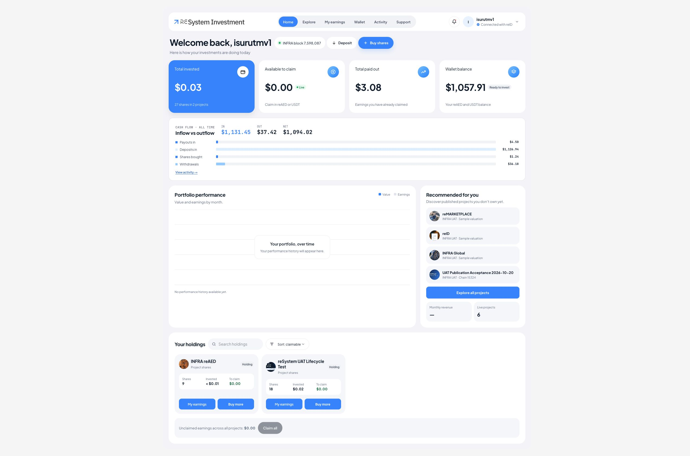
1. **Use the navigation.** Explore finds projects; My earnings shows rewards; Wallet and Activity track assets and records.
2. **Read the summary cards.** Portfolio value, claimable rewards and wallet balance describe different things.
3. **Check the portfolio below.** Scroll to Your holdings for the projects and quantities you actually own.
**Remember:** Screens show one UAT account on 23 Oct 2026. Values change; they are not example amounts you should send.
Screenshot: 23 October 2026.

### Visual 03. Deposit into your connected wallet
Open: **Wallet > Deposit**
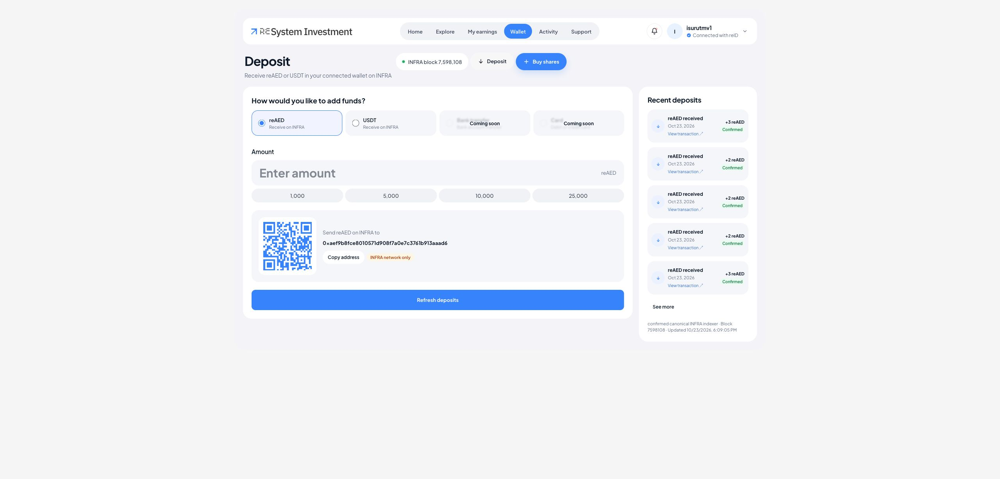
1. **Choose reAED or USDT.** Use the supported asset on INFRA. Bank/card options marked Coming soon are unavailable.
2. **Copy your own address.** Use the live address or QR from your account. Check network, address and amount in the sending wallet.
3. **Refresh after confirmation.** The app records confirmed deposits after indexing. Entering an amount here does not send money.
**Remember:** Do not send to the address or scan the QR in this guide. Open your own live Deposit screen. Keep reAED for fees, even when paying with USDT.
Screenshot: 23 October 2026.

### Visual 04. See your five latest deposits
Open: **Deposit > Recent deposits**

1. **Read asset and confirmation.** Each card shows the asset, amount and date of a received payment.
2. **Open the transaction link.** Use the explorer link to inspect the underlying confirmed movement.
3. **Choose See more.** This opens Activity with the Deposits filter selected for the full paginated history.
**Remember:** A claim or proceeds withdrawal can also appear as an incoming deposit. Do not count the same transaction twice.
Screenshot: 23 October 2026.

### Visual 05. Explore the published projects
Open: **Explore**
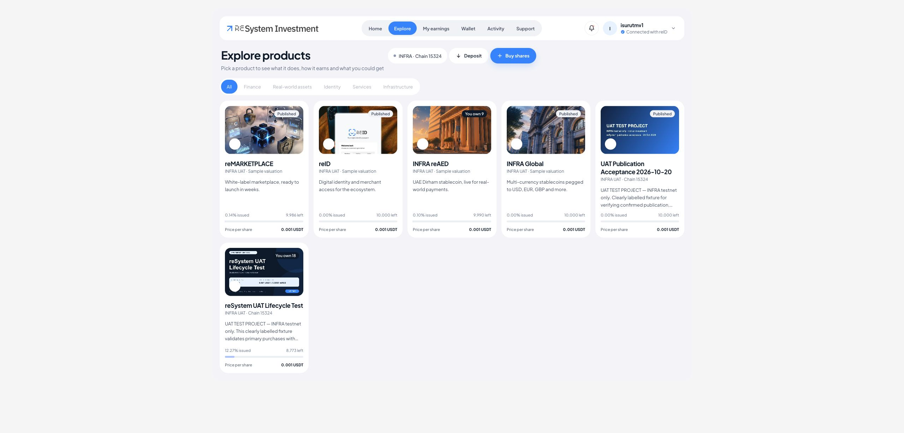
1. **Read the project cards.** Check the project name, image and published information.
2. **Open a project.** Read its details, available supply, price and documents before buying.
3. **Compare actual revenue.** Treat funded revenue records separately from indicative yield or expectations.
**Remember:** These are UAT sample valuations. Future revenue and a resale buyer are not guaranteed.
Screenshot: 23 October 2026.

### Visual 06. Read the project before buying
Open: **Explore > Project details**
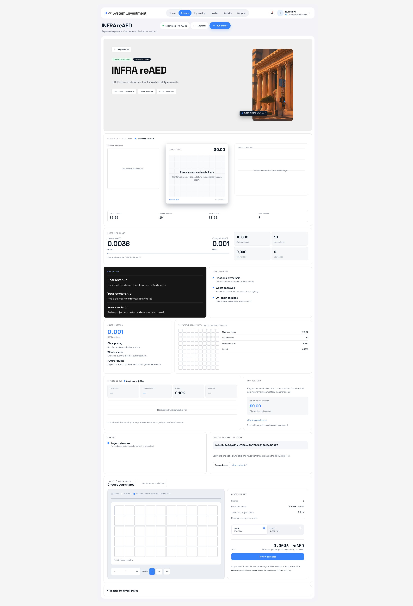
1. **Confirm the project.** Check the name, purpose and published description before selecting shares.
2. **Read the project information.** Scroll through the project overview, supply, price and actual revenue details.
3. **Check published documents.** Review any supporting documents before moving to Choose your shares.
**Remember:** A dash or unavailable message is not always zero. Do not treat a projected yield as already funded rewards.
Screenshot: 23 October 2026.

### Visual 07. Choose shares and check the total
Open: **Project > Choose your shares**

1. **Choose a whole quantity.** Use the quantity control or presets. Confirm the selected share of the project.
2. **Select the payment asset.** reAED pays natively; USDT may require a separate limited allowance. Both need reAED for fees.
3. **Review the current total.** Wait for the matching quote, check the total, then select Review purchase.
**Remember:** The total shown is the purchase price. Network fees are extra and are checked in the transaction review.
Screenshot: 23 October 2026.

### Visual 08. Prepare, then approve in reID
Open: **Review purchase**
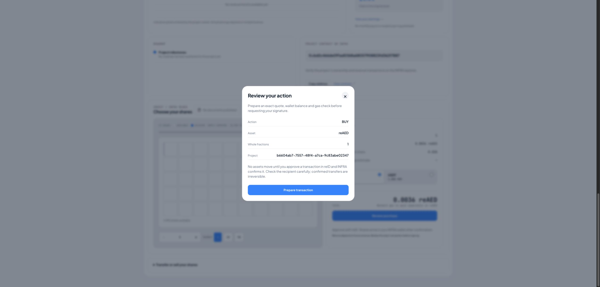
1. **Check the initial action.** Confirm the project, asset and whole-fraction quantity.
2. **Prepare the transaction.** The app checks price, balance and fee and creates the exact review.
3. **Approve only the matching review.** Select Request reID approval when available, review in reID yourself, then follow the existing request in Activity.
**Remember:** This screenshot is the first review stage. No purchase happens merely by opening it. If a submitted result is uncertain, inspect it before retrying.
Screenshot: 23 October 2026.

### Visual 09. Find and use your holdings
Open: **Home > Your holdings**

1. **Find the right project.** Use project names/images and the search/sort controls.
2. **Read quantity and claimable value.** Shares are token quantity; To claim is funded rewards, not cash already in your wallet.
3. **Use the next-action buttons.** My earnings opens rewards; Buy more returns to the project purchase flow.
**Remember:** ERC-1155 example: 100 fractions can appear as one NFT card with Qty 100. Missing external artwork does not mean the tokens are missing.
Screenshot: 23 October 2026.

### Visual 10. Transfer fractions to another wallet
Open: **Project > Transfer or sell your shares**
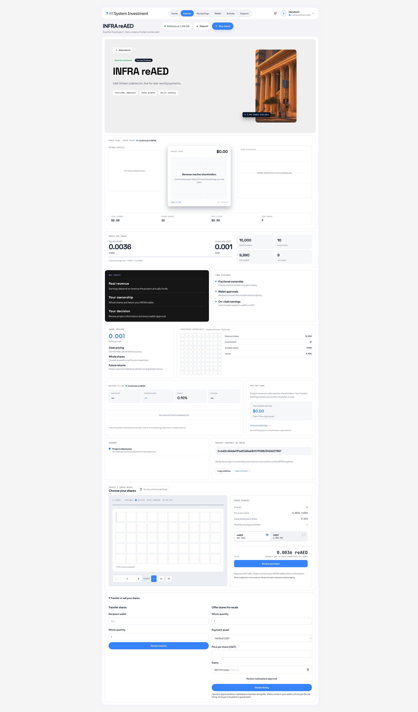
1. **Open Transfer or sell your shares.** Find this section near the bottom of the project page.
2. **Enter recipient and quantity.** Check the complete wallet address and choose a whole number within your holdings.
3. **Review and approve the transfer.** Use Review transfer, then approve the matching INFRA action in reID. Wait for confirmed records.
**Remember:** Sending 20 of 100 leaves 80 for you and gives the recipient quantity 20 of the same project token ID 1. Past earned rewards stay with their earner.
Screenshot: 23 October 2026.

### Visual 11. Offer shares for resale
Open: **Project > Transfer or sell your shares**

1. **Enter listing terms.** Choose whole quantity, payment asset, price per share and expiry.
2. **Approve the operator if needed.** Review marketplace permission for this project. It is separate from the listing itself.
3. **Review the listing.** Approve the listing in reID. Monitor fills/expiry; claim seller proceeds separately when available.
**Remember:** A listing does not guarantee a buyer. Cancelling cannot undo a completed fill. Operator approval covers the project token, not only a fixed quantity.
Screenshot: 23 October 2026.

### Visual 12. Check and claim funded rewards
Open: **My earnings > Shareholder pool**
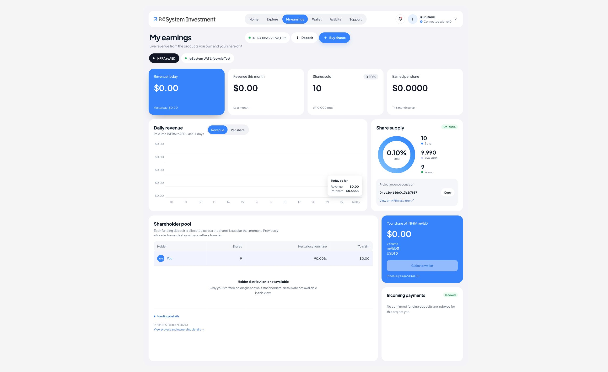
1. **Choose the intended project.** Select the project at the top of My earnings, then find its claim card. Confirm the project name before continuing.
2. **Check what is claimable.** Only funded rewards can be claimed. A zero balance can leave the claim action disabled.
3. **Review the claim and fee.** Use the available claim action, approve in reID and check the wallet after confirmation.
**Remember:** A claim does not sell shares. Already-earned rewards remain claimable after you transfer or sell your entire holding.
Screenshot: 23 October 2026.

### Visual 13. Send wallet funds or sell shares
Open: **Wallet > Withdraw**
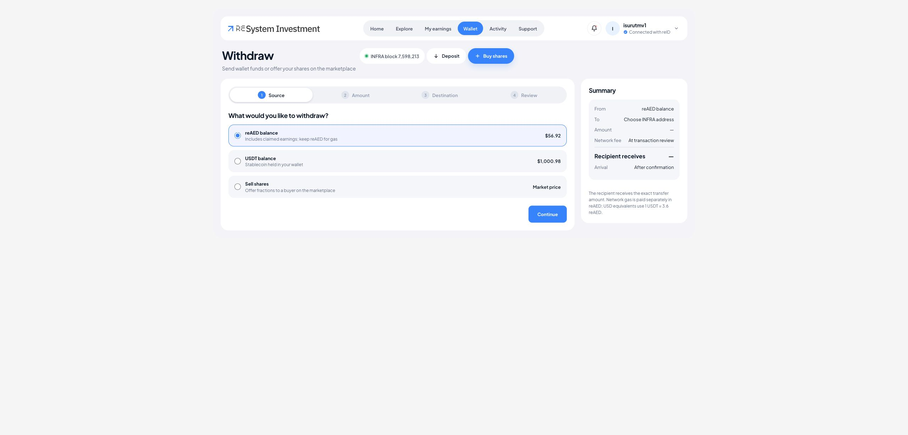
1. **Choose the source.** Select reAED, USDT or Sell shares. Selling shares follows the marketplace flow.
2. **Enter amount and destination.** For a wallet transfer, continue through amount and the full INFRA recipient address.
3. **Review before approving.** Check asset, recipient, amount and fee. Approve in reID only when all values match.
**Remember:** Sending wallet funds is different from claiming rewards or selling fractions. The recipient gets the reviewed transfer amount; gas is separate.
Screenshot: 23 October 2026.

### Visual 14. Track activity and get help
Open: **Activity**
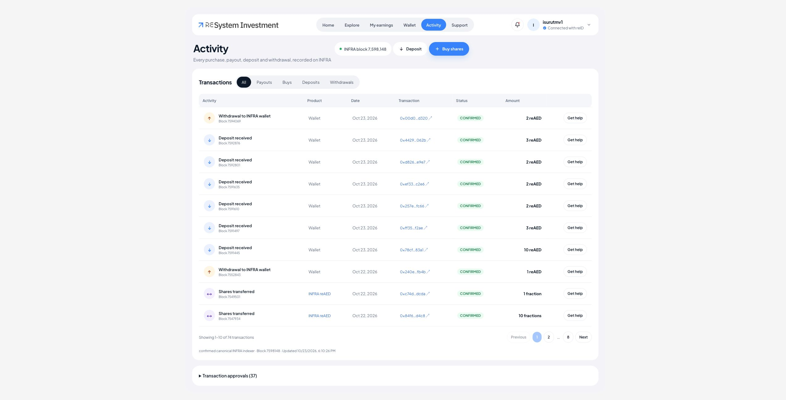
1. **Filter the history.** Use All, Payouts, Buys, Deposits or Withdrawals.
2. **Use page numbers and totals.** Browse the server-filtered records; Showing X-Y of Z tells you where you are.
3. **Inspect the request or ask for help.** Use transaction links, the Transaction approvals section and Get help for a specific record.
**Remember:** For support, describe the action/time/error and include its public hash. Private screenshots: PNG, JPEG or WebP up to 3 MiB. Never include keys or codes.
Screenshot: 23 October 2026.

### Visual 15. Manage notifications and email
Open: **Notifications**
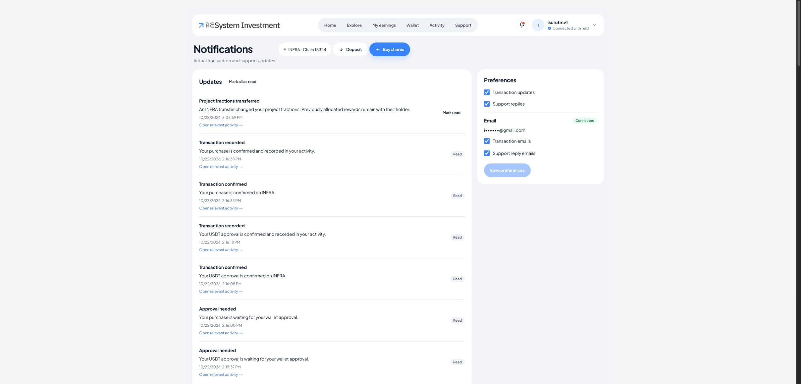
1. **Read the update.** Open relevant activity to inspect the underlying transaction or support event.
2. **Mark updates as read.** Use Mark all as read to clear unread notifications. This does not approve transactions.
3. **Save your preferences.** Choose in-app and email categories, then Save preferences. Email comes from your authenticated reID profile.
**Remember:** No second email confirmation is required. Your opt-outs are respected. Use Support for a private ticket and sign out when finished.
Screenshot: 23 October 2026.
<!-- VISUAL WALKTHROUGH END -->

## Detailed reference
The following sections explain the rules, exceptions and troubleshooting behind the visual walkthrough.
## 1. What you can do

reSystem lets you buy whole project fractions, hold them in your connected wallet, receive rewards from actual project revenue deposits, transfer fractions and offer them for resale. The app brings your holdings, wallet activity, claims, notifications and support together.

This guide covers the current **INFRA UAT/testnet, chain 15324**. The projects shown for testing have sample valuations. Use the agreed UAT funds and test plan; this environment is not the production launch.

The basic journey is:

**Connect reID -> fund your wallet -> explore a project -> review a purchase -> approve in reID -> track confirmation -> manage holdings and rewards.**

Adding money to your wallet does not automatically buy shares. Selecting shares or preparing a review also does not complete a purchase. You approve each transaction separately in reID.

## 2. Sign in with reID

1. Open the investor app and choose the reID connection/sign-in action.
2. Complete the login and any security steps in reID yourself.
3. Review the requested consent. Return to the investor app after completing the flow.
4. Confirm that your own profile and wallet are shown before using Wallet or buying shares.

Never give support or an administrator your wallet private key, password or authenticator code. If sign-in expires, reconnect through the app. If you use a different reID account, confirm its wallet before sending or investing.

## 3. Find the feature you need

| Area | What it shows or lets you do |
| --- | --- |
| Home | Your holdings, claimable amounts, project images and recommendations |
| Explore | Published projects and their available investment information |
| Project page | Description, price, supply, revenue history, documents where published and purchase controls |
| My earnings | Actual funded rewards and available claim actions, including retained rewards after a sale/transfer |
| Wallet | Your connected wallet and supported balances; deposit and send/withdraw routes |
| Activity | Confirmed purchases, payouts, deposits, withdrawals and other recorded actions; ongoing requests are tracked separately |
| Marketplace | Available resale listings and management of your own listings/proceeds |
| Notifications | Transaction/support updates, Mark all as read and delivery preferences |
| Support | Getting-started help, private tickets, replies and permitted screenshot attachments |

Use the links and actions in each area to move between the related screens. A blank dash or unavailable message means data is not ready or could not be read; it does not always mean zero.

## 4. Add funds to your wallet

1. Open **Wallet**, then **Deposit**.
2. Choose the supported asset: native **reAED** or the verified **USDT on INFRA**.
3. Check the displayed wallet address and network. Copy the address or scan the QR with your sending wallet.
4. In that sending wallet, review the actual network, token, address and amount before sending.
5. Return to reSystem and use **Refresh deposits** after confirmation. The sidebar shows the five most recent deposits. **See more** opens Activity filtered to Deposits.

Only send on the displayed INFRA network. A token called USDT on another chain is not automatically the supported INFRA token. Bank transfer and card options marked **Coming soon** cannot currently add funds.

Entering an amount on the Deposit page does not charge a card, initiate a transfer or credit your balance. The sending wallet controls the actual transfer. A QR is a receiving aid; check the final transaction in the sending wallet.

Keep enough reAED for network fees even if you plan to pay with USDT. A USDT allowance and the purchase can be separate transactions, each with its own fee. Fees are additional to the purchase price and must be checked in each review.

## 5. Understand a project before buying

Open Explore or a published project from the landing page. Read the description, total value, maximum/available fractions, per-fraction price and any published documents. Check whether the primary sale is open. Review actual revenue records separately from any indicative yield.

| Term | Meaning |
| --- | --- |
| Fraction / share | One whole unit of a project's on-chain ownership token |
| Price per share | The amount needed to buy one fraction in the selected asset |
| Available | Remaining primary supply; purchase also requires an open sale |
| Selected project share | Your selected quantity divided by the project's maximum supply |
| Revenue / rewards | Actual deposited revenue and your resulting entitlement |
| Yield or estimate | Descriptive/indicative information, not a guaranteed payment |
| To claim | Funded reward currently available to claim, subject to fresh execution checks |

Returns depend on actual future revenue deposits. Resale depends on a willing buyer. Neither a displayed forecast nor a listing guarantees income or a sale.

## 6. Buy fractions with reAED

1. Open the intended project and choose the number of whole shares.
2. Select **reAED**. The total updates as you change the quantity. The app also obtains a fresh matching quote before review can proceed.
3. Check your balance covers **both the purchase and the network fee**.
4. Select **Review purchase**, then prepare the transaction if requested.
5. Read the review: correct project, quantity, payment asset, total, receiving wallet, INFRA network, fee and expiration.
6. Select **Request reID approval** when ready. Personally review and approve the same action in reID.
7. Return to the app and follow the existing request in Activity. Wait for confirmation and the holdings update.

**Example using the current UAT sample price:** one fraction is 0.0036 reAED, so 10 fractions cost 0.036 reAED before fees. Your project may have a different price; always use its current review.

If the amount or project differs in reID, stop and reject it. If an unsigned review expires, prepare a fresh one. If you may already have approved/submitted it, check the existing request or transaction hash before trying again.

## 7. Buy fractions with USDT

1. Select **USDT** on the project page and choose the quantity.
2. Keep enough USDT for the purchase and enough native reAED for fees.
3. If the app requests a token allowance, review the exact limited USDT amount and the project/marketplace spender. Approve that allowance in reID only if it matches.
4. Wait for the allowance to confirm. It gives permission to use the specified token amount; it does **not** buy the shares.
5. Review and approve the separate purchase in reID.
6. Follow its confirmation and check the resulting holding.

At the current sample price, 10 shares cost 0.01 USDT before fees. Do not approve an unlimited or different allowance just because it is convenient. Approval and purchase are separate actions and can incur separate network fees.

## 8. What NFT do you receive?

Each project uses an ERC-1155 token. The token ID is **1** within that project's collection, and your fraction count is its quantity. A wallet may show one NFT card with “Qty 100” for 100 fractions; you do not receive 100 separately named NFT cards.

If you hold 100 and transfer 20 to another wallet, your balance becomes 80 and the recipient receives quantity 20 of the **same project token ID**. The recipient does not need a new unique ID minted for that transfer.

The current external explorer and some wallet displays can show **Unnamed token** or missing artwork because of collection-name support and an external IPFS gateway/cache problem. Application project images and token metadata are intact. A missing picture does not establish that your fractions are missing. Check the correct INFRA network, project contract, token ID and confirmed balance/Activity. The explorer operator is handling its display configuration; do not repeat a purchase to fix artwork.

## 9. Holdings and transfers

Home shows your actual held quantities, project images and available shortcuts such as **My earnings** and **Buy more**. Search/sort controls help locate a holding. A displayed acquisition value is not a guaranteed resale value or cash balance.

To transfer fractions, open the holding/project's transfer action, enter a whole quantity and the recipient wallet, then review and approve through reID. Check the full recipient address and network carefully. A confirmed transfer cannot be undone by the app.

After transfer, wait for the chain and Activity/holdings view to update. Rewards you already earned remain claimable even after you transfer all shares. Future revenue is allocated to whoever holds the fractions when that revenue is deposited.

## 10. Claim your earnings

Open **My earnings** to view rewards from actual funded revenue. Where available, the app offers an individual asset claim, both assets together, or a batch across eligible projects. Read the selected asset/project list and current amounts carefully; final claimable amounts are determined by the contracts at execution.

1. Select the intended claim action.
2. Check the project(s), asset(s), recipient, network and fee in the review.
3. Approve the claim yourself through reID.
4. Follow its confirmation, then check the wallet and updated claimable balance.

A claim sends earned assets to your wallet; it does not sell your shares. Small claims may be uneconomical relative to the current network fee. The app does not guarantee future rewards, and it cannot create a payout from an estimate alone.

Example: if you earn a reward and then transfer every fraction away, that already-earned reward stays yours to claim. A later deposit belongs to the holders at that later time.

## 11. Resell or buy through the marketplace

Resale is separate from buying newly issued primary shares. Inspect each listing's project, asset, price, quantity remaining and expiry.

### Offer your fractions for sale

1. Open the marketplace/listing action for your holding.
2. If required, review the marketplace operator permission for this project's fractions. This ERC-1155 permission covers the project token rather than a fixed listing quantity; understand it before approving.
3. Choose the whole quantity, payment asset, price and listing expiry.
4. Review and approve the separate listing transaction in reID.
5. Monitor the listing. It may be partly filled, fully filled, expire or be cancelled. A listing is not proof of a sale.

### Buy a resale listing

Choose an active listing and quantity within its remaining availability. Review its exact cost and any required limited USDT allowance. Approve the allowance and purchase as separate steps where requested. Availability can change while someone else buys; use a fresh review if the listing state changed.

### Cancel and collect proceeds

Use the cancellation action for your remaining open listing when available, then approve its review. Cancellation cannot undo an already completed fill. Seller proceeds are separate from project rewards and may require **Withdraw proceeds** in the relevant asset. Review and approve that withdrawal to receive them in your wallet.

Selling all fractions does not erase previously earned project rewards. It also does not guarantee that a new buyer will fill another listing.

## 12. Send assets from your wallet

Use the Wallet send/withdraw route to choose the supported asset, recipient and amount. Check the full address; a name or shortened address alone is not enough. **Max** uses the current estimate/reserve for supported transfers and is rechecked before approval. Fees or balances can change before signing.

Review the receiving wallet, asset, amount, INFRA chain and fee, then approve through reID. This sends wallet assets; it does not withdraw project treasury funds or sell fractions. Record the existing transaction hash if a result is delayed, and do not repeat an uncertain transfer.

## 13. Activity and transaction messages

Activity filters include **All, Payouts, Buys, Deposits and Withdrawals**. Page numbers, Previous/Next and “Showing X-Y of Z” let you browse the server-filtered history. Deposit's See more link opens the Deposits filter directly.

One transaction can produce multiple relevant records. Incoming claim/proceeds payments can also appear in Deposits. These views are not separate credits to be added together. Use the transaction link and asset/amount to understand the underlying movement.

| Message | What it means |
| --- | --- |
| Preparing/checking quote | Waiting for a fresh price/balance/fee check; no purchase completed |
| Approval needed | Your review is waiting for action in reID |
| Submitted / broadcast | Track the existing request; do not create another one |
| Confirmed | The network accepted it; app history/holdings may still be indexing |
| Recorded / indexed | The application has reflected the confirmed chain effect |
| Rejected | Approval was declined; no successful action is established |
| Review expired | An unused review timed out; start fresh only if it was not already submitted |
| Failed / uncertain | Read the actual message; for uncertainty, contact support before retrying |

**Insufficient funds** may mean you have the purchase asset but not enough reAED for the fee. **Sale closed/supply changed** requires reviewing the project's current availability. **Session expired** requires reconnecting. **Service unavailable** is not evidence that a previously submitted transaction failed.

Use Refresh status on the existing request when available. Blockchain confirmation, provider updates and indexer processing are separate steps, so a short delay does not mean a second approval is needed.

## 14. Notifications and email preferences

Open Notifications to read transaction and support updates. Use **Mark all as read** to clear unread updates across your notification history. Reading a notification does not approve a transaction or change a balance.

In Preferences, choose the supported transaction/support categories and save. The app uses the email associated with your authenticated reID profile; it does not ask you to confirm the same email again. If your reID profile has no email, email delivery is unavailable until the profile supplies one. Manage your identity email through reID and reconnect as needed; do not send it to support as a substitute for authentication.

In-app and email preferences are separate controls. Existing opt-outs are respected. Check the saved confirmation or an error message after a change. If a notification references an uncertain financial action, inspect that action before attempting it again.

## 15. Get help and finish safely

Open **Support** for getting-started help or a private ticket. Describe the page, action, time and message you saw. Include the public transaction hash if relevant. You can attach a PNG/JPEG/WebP screenshot up to 3 MiB using the paperclip; remove secrets and unrelated personal information first.

If the message saved but an attachment did not, retry only the attachment when offered. Do not send repeated copies of a ticket while waiting for the view to refresh. Support staff can investigate records but do not need your private key or authenticator code.

Before signing out, check whether any approval is still waiting in reID and whether a submitted transaction has a known hash/status. Signing out does not reverse a confirmed transaction. On shared devices, finish by signing out of the application and following your reID account's security practices.

For client testing, include **CLIENT-UAT-2026-10-23**, your browser/device, route and redacted reproduction steps in a report. The external NFT display limitation and complete device/client acceptance remain tracked separately. This guide describes available UAT features, not a promise of guaranteed returns or a production release.
