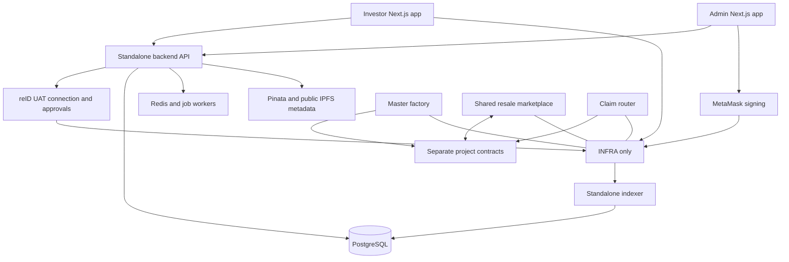

# reSystem Investment — implementation plan and session handoff

**Saved:** 16 October 2026, Asia/Dubai
**Document purpose:** durable technical plan, implementation scope and continuation instructions for future Codex sessions.
**Delivery state:** implementation approved by the user on 16 October 2026. The five independent repositories are being implemented and verified on INFRA UAT. Production release remains separate.
**Canonical backlog:** [`tasks.json`](tasks.json), 120 tracked tasks (105 original tasks and fifteen approved follow-ups). Current statuses/evidence are synchronized from the live Notion board; dated initial snapshots below are historical. The 21 October additions cover guarded automatic server deployment, the stable QA/public-media handover, the four landing publications and actionable purchase errors; neither certifies full client acceptance or enables a new financial window.
**Continuation entry point:** [`START_HERE.md`](../../START_HERE.md).
**Notion project:** [reSystem Investment project workspace](https://app.notion.com/p/3fb3b21ac925815cab02d74e0f79fc0b).

Private project records: [Documents library](https://app.notion.com/p/02d0e65d064b4316b6fbe3a9c466434f), [Services inventory](https://app.notion.com/p/772a663cc1334f269b73e144c998f089), [Development Credentials](https://app.notion.com/p/3fb3b21ac925812da705f4394432fe55), and [Maintenance workflow](https://app.notion.com/p/3fb3b21ac9258126a8cdf47262d97fb2). Credential values stay on the dedicated private credential page; these links contain no values.

## 1. Read this first in a new session

1. Read the repository `AGENTS.md`, this document and `START_HERE.md` before implementation. For Next.js work, read the relevant bundled documentation in `node_modules/next/dist/docs/` before coding; this repository uses Next.js conventions that may differ from remembered versions.
2. Inspect `git status`, the current branch, recent commits and attached worktrees. Preserve existing work. Do not reset or overwrite the live-deposit implementation described below.
3. Read the linked Notion project and task board. Select an unblocked task, review its requirements, acceptance criteria and dependencies, and move it from **To do** to **In progress** before starting.
4. Resolve the economic decisions explicitly marked **proposed** before their dependent implementation. Do not turn a proposal into a confirmed user requirement silently.
5. Keep investor frontend, admin frontend, backend, contracts and indexer in separate repositories. This is not a monorepo migration.
6. Implement the task, run meaningful checks, review the diff and commit the actual work. Attach the real GitHub commit URL and verification evidence to its task before changing it to **Done**. A plan, uncommitted change or generated placeholder commit link is not completion evidence.
7. Update durable documentation when a decision, interface, environment or implementation state changes. Archive all project documents in the existing private Notion project and maintain its Services inventory as tools/services are added or changed. Do not rely on the preceding chat being available.
8. The user has authorized storing this project's actual development/testnet credential values in the dedicated private Notion **Development Credentials** page. Literal credentials must not appear in Git, local handoffs, general documentation, task bodies, the client PDF, test fixtures or logs. General pages may link to the credential page; runtime values use protected environment injection. Existing credentials may be used for authorized development/testnet work; rotate them before live production. Rotation is not a blocker for current development.

### Decision change register — 16 October 2026

- The existing private Notion project is the archive for all project documents. Future sessions archive additions/revisions there and keep Services current with purpose, environment, owner, hosting target, verified runtime status and a credential-page reference.
- Development/testnet credential values belong only in the dedicated private Notion Development Credentials page as a documentation record, under the user's existing authorization. No literal values belong in local handoffs, Git, the client PDF, task bodies, logs or general documents. Protected runtime environment storage remains necessary; rotate credentials before live production.
- Investor frontend hosting is confirmed as Vercel. Admin frontend, NestJS backend, PostgreSQL, Redis/workers, indexer and any approved optional GraphQL layer target the FP server accessed through Teleport. The FP server is the user-confirmed Teleport node `footprint.frontend`. This records the hosting decision; read-only SSH access as `resystem` and Docker availability have been verified. Deployment is underway; current verified state and recovery notes are in IMPLEMENTATION_STATUS.md.
- Current INFRA work is testnet/UAT. REST/OpenAPI remains the initial API plan; the GraphQL hosting decision does not make GraphQL a required implementation.
- All 105 implementation task IDs and dependencies are preserved. Initial task JSON statuses are a planning snapshot; current progress and real commit/test evidence are in Notion and the implementation status document. The user approved implementation and UAT setup in this conversation; future sessions must read the current user request and verified state before acting.

- **16 October 2026 publication-policy update:** the reserved GLOBAL super-admin may publish directly without independent project review; ordinary publishers retain review. This changes no metadata, permission, wallet-signing, contract/economic or financial-approval safeguard. See the detailed approved exception in section 10. Backend/admin source and checks are recorded in section 10; bounded live verification remains pending and no reviewer account was created.

### Tracking conventions

- **To do:** not started or awaiting dependencies/decisions.
- **In progress:** an identified owner is actively implementing or verifying it.
- **Done:** acceptance criteria met, required checks passed, review completed and real GitHub commit evidence attached.
- If work is blocked, retain an honest non-Done status, record the blocker and dependency, and continue an independent task where possible.
- Use `RSI-###` as the stable task identifier across Markdown, JSON, Notion and commits. One commit may support multiple tasks; one task may link several commits. Each link must refer to actual committed work.
- Reconcile the task JSON and Notion when changing scope or statuses. Notion is the working project board; this repository is the portable specification/backlog snapshot. Record the most recent synchronization time in the continuation notes.
- Archive every new or revised project document in the private Notion project. Update the Services inventory whenever a tool/service is added or its configuration, owner, environment or deployment state changes; distinguish the confirmed hosting target from observed runtime evidence. Keep actual credential values exclusively in the dedicated private Development Credentials page, with references from general records.
- The initial snapshot contained 105 tasks in **To do**; current working status lives in Notion. Existing work is described as a baseline, not falsely marked as a completed production-platform task.

## 2. Approved starting baseline and continuation

| Item | State when this plan was approved |
|---|---|
| Working directory | `/Users/isurutmv/Developer Office/reSystem/workspaces/ReSystem-Investment-front-end` |
| Investor repository | `git@github.com:reIDentity/ReSystem-Investment-front-end.git` |
| Branch | `dev` |
| Baseline commit | [`5ed81805b92004e9ce206e127a31ac567b536bc1`](https://github.com/reIDentity/ReSystem-Investment-front-end/commit/5ed81805b92004e9ce206e127a31ac567b536bc1), “Connect reID UAT sign-in and unify investor branding” |
| Frontend | Next.js, React, TypeScript; retain approved blue branding, assets and responsive layouts |
| Sign-in | Real reID UAT authorization-code/PKCE flow, verified user wallet and encrypted session |
| Current SDK | `fpreid-connect-sdk` 0.3.0; transaction permission/integration still needs a dedicated proof and implementation |
| Deposit work | Real session-derived wallet address/QR, actual INFRA incoming history, real indexed block/failure states; bank/card blurred and disabled with Coming soon |
| Remaining investor flows | Largely demo state: investment holdings, buying, earnings, resale/withdrawal assumptions and other sample activity must be replaced |
| Existing public deployment | `https://re-system-investment-front-end.vercel.app/` |
| Local HTTPS development | `https://localhost:3002`; existing local self-signed certificate setup |

The current implementation and target runtime evidence are maintained in [IMPLEMENTATION_STATUS.md](IMPLEMENTATION_STATUS.md); the following records the starting baseline.

The live-deposit baseline was reviewed, passed 10 unit tests, four HTTPS integration tests, lint and the production build, and was published as [`39daec7`](https://github.com/reIDentity/ReSystem-Investment-front-end/commit/39daec7d63ccf8100eba75e70b1de2a9efb5b09b). Its areas are:

- `src/lib/deposits.ts` — actual explorer normalization, exact units and failed/partial data handling.
- `src/app/api/invest/deposits/route.ts` — authenticated, session-derived address and generated QR.
- `src/components/invest/Deposit.tsx` — actual wallet/history UI and disabled coming-soon methods.
- `src/app/invest/(authenticated)/deposit/page.tsx`.
- `src/components/invest/InvestorUI.tsx`, `WalletFlows.tsx` and `src/app/invest/investor.css`.
- `package.json`, lockfile, `README.md`, `tests/deposits.test.mjs` and `tests/auth.integration.mjs`.

The earlier deposit verification checked two real incoming native reAED transfers and independently verified the actual QR payload; it did not create a financial transaction. Re-run relevant checks against the current working tree before creating a baseline commit. Do not copy a particular test user's wallet or historical transaction into production defaults.

The existing deposit implementation is a useful live baseline, not the final reliable indexer. It queries recent explorer activity; the planned standalone indexer adds durable history, recovery and reconciliation. Refreshing a deposit page never credits a user-entered amount.

### Environment facts to reverify

- Current development targets **INFRA testnet/UAT**, chain ID **15324**; live production remains a separately approved release target.
- Public explorer: `https://uat.scan.infraworld.org`.
- Native asset: **reAED**, 18 decimals in the current verified UAT configuration.
- Verified UAT USDT: `0x576bb1a9fcb1115c3df5f66ac8d12245fd7dadcf`, 6 decimals.
- reID UAT API: `https://uat-wallet.reidentity.net`; reID approval app: `https://app.reidentity.net`.
- Registered investor callback origins include localhost port 3002 and the existing Vercel deployment. Review actual client registration privately when backend callback topology changes.
- Do not assume a later production INFRA environment uses these UAT addresses, RPC capabilities or finality settings. Record and validate an authoritative deployment manifest.
- The private Notion Development Credentials page is the authorized register for actual development/testnet credential values. Keep operational values in protected runtime environments; existing `.env.local`, `.env.vercel.local` and local certificates are ignored and must stay out of Git, local handoffs and client artifacts. Rotate development credentials before live production.

## 3. Confirmed requirements and open decisions

### Confirmed by the user

| Area | Required behavior |
|---|---|
| Blockchain | **INFRA only** for ownership, purchases, resale and rewards |
| Investor connection | Connect through **reID** |
| Payment assets | Accept **native reAED or verified USDT directly**; no mandatory swap |
| Fixed pricing rule | **1 USDT = 3.6 reAED** |
| Project listing | Images, required project content, total project value and maximum fraction count |
| Fraction price | Derived from total project value divided by maximum fractions |
| Primary ownership | Buy whole fractions; buying again increases the same project holding |
| Ownership token | NFT-compatible ownership with quantity-based partial transfers; ERC-1155 is the proposed matching standard |
| Contract structure | One master factory/registry and a distinct contract per project |
| Revenue funding | Project owner deposits actual funds into that project's pool |
| Revenue eligibility | **Only sold/issued fractions share each new allocation**; unsold inventory receives nothing |
| Historical rewards | Previous holder keeps already allocated rewards; recipient earns from future allocations |
| Transfer eligibility | Any INFRA wallet may receive and trade fractions; no contract reID/KYC receiving allowlist |
| Resale | Investor-to-investor marketplace in the first release, including partial quantities |
| Yield display | Owner enters yield manually; it is independent of funded claimable rewards |
| Admin access | Username/password login, then MetaMask and reID wallet connections for signing |
| Publication review | Reserved GLOBAL super-admin may directly publish without independent review; ordinary publishers retain independent review and all other publication/signing safeguards |
| Admin management | Projects, owners, users, staff roles and permissions |
| Repositories | Separate repositories for each frontend, backend and smart contracts; standalone indexer also separate |
| Project tracking | Every task tracked To do → In progress → Done, with real GitHub commit evidence |
| Project records | All project documents archived in the existing private Notion project; Services maintained as tools/services are added or changed |
| Development credentials | Actual development/testnet values recorded only in the dedicated private Notion Development Credentials page; rotate before live production |
| Hosting | Investor frontend on Vercel; admin frontend and all other project services on the FP server accessed through Teleport; optional GraphQL follows the same FP target if approved |
| Current network | INFRA testnet/UAT; production release remains separately approved |

### Approved defaults — 16 October 2026

| Proposal | Reason and dependency |
|---|---|
| Zero platform/marketplace fees at launch | No fee has been specified; do not introduce fees without a decision. |
| Revenue allocated to balances at the funding transaction | Approved deterministic allocation at the funding transaction, without time-weighted monthly participation. |
| No guaranteed platform buyback or immediate liquidity | Resale matches willing investors; remove the demo's implied instant redemption. Approved; client wording must explain willing-buyer resale. |
| Fixed project implementations, with new versions for future projects | Avoid changing existing project economics through silent upgrades; approved fixed versions, with a delay for future implementation activation. |
| Owner-held **issued** fractions participate like other issued fractions | “Sold-only” excludes unsold/unminted inventory. Approved: owner-acquired issued fractions participate like every other issued holder. |
| Reward rounding reserves cannot be redirected to later buyers | Approved: retain unallocated division remainders and wallet fractional entitlements permanently; no reserve rescue or transfer to later buyers. |
| Project value is an economic reference, not a guaranteed redemption reserve | Approved economic reference; token terms must describe the actual rights without a guaranteed redemption promise. |
| Initial sale has no automatic principal refund/cancellation mechanism | No funding target, escrow deadline, refund or guaranteed buyback has been requested. Approved v1 has no principal refund or cancellation mechanism. |
| No time-weighted revenue eligibility, transfer tax, auction, lending or automated reinvestment | Keep scope aligned; add only through an approved requirement/task revision. |

Other decisions to settle during specification: eventual live-production network manifest, authorized revenue funders, treasury destination-change workflow, transfer/claim emergency powers, metadata freezing policy, initial project economics, admin MFA/recovery, signer quorum and support/notification channels. The current development/testnet target is already confirmed.

## 4. Economics and exact arithmetic

### Fraction issue model

For a project:

- `N` = immutable maximum whole fractions.
- `T` = total project value in USDT atomic units (6 decimals on the verified UAT asset).
- `p = T / N` = USDT atomic price per fraction.
- `S` = total sold/issued fractions; it grows only through successful primary purchases and must never exceed `N`.
- `h` = an individual wallet's current fraction balance.

Publishing rejects `N = 0`, non-positive price, overflow/invalid bounds and `T % N != 0`. No JavaScript floating-point rounding may change these economics. Frontends send decimal strings; services and contracts use exact base units.

With 18-decimal native reAED and 6-decimal USDT:

```text
reAED atomic units = USDT atomic units × 3,600,000,000,000
```

Example:

| Field | USDT | reAED |
|---|---:|---:|
| Project value | 100,000 | 360,000 |
| Maximum fractions | 10,000 | 10,000 |
| Price per fraction | 10 | 36 |
| Buy 100 fractions | 1,000 | 3,600 |

The fixed 3.6 rate is a protocol pricing rule. Accepting both assets does not automatically swap them or promise outside redemption at that rate. Quotes identify asset, quantity, unit price, total, chain, contract and validity/stale-price checks.

### Two percentages with distinct meanings

```text
Project fraction entitlement = h / N
Revenue participation at allocation = h / S
```

If `N = 10,000`, `S = 2,000` and a holder has `h = 1,000`, that wallet has 10% of the project's defined fraction entitlement and 50% of the next allocation to issued fractions. If another 2,000 fractions sell before a later allocation, that wallet still has 10% of the defined maximum but participates with 25% of that later allocation.

Both values must be labelled accurately. A manual indicative yield cannot replace these calculations or promise an actual distribution.

### Financial buckets

| Bucket | What enters it | Who can collect it |
|---|---|---|
| Primary-sale proceeds | Successful first-sale investment payments | Authorized project treasury, subject to proceeds accounting |
| Project reward pool | Actual owner/authorized finance revenue deposits | Eligible historical holders through claims |
| Marketplace proceeds | Completed investor resale payments | The corresponding seller |
| Investor wallet | Direct incoming transfers and completed payments/claims/proceeds | Wallet owner through approved wallet transactions |

These obligations are isolated by asset and purpose. Primary principal is not automatically revenue. A wallet deposit is not automatically a project purchase. A sale-proceeds withdrawal cannot consume investor reward liabilities.

## 5. Ownership standard and project contracts

### ERC-1155 per project

Use an ERC-1155 project contract with ownership token ID `1` and whole quantity balances:

- Buy 1,000 fractions → balance 1,000.
- Transfer 10 → sender 990; recipient 10.
- Buy another 100 → balance increases by 100.
- All standard direct and batch transfer routes run the same reward-settlement logic.

This meets NFT-compatible metadata and wallet transfer expectations while allowing divisible quantities. Do not create a parallel ERC-721 certificate that claims separate ownership authority. The ERC-1155 balance is authoritative.

Maximum supply and initial economic terms become immutable at publication. Mint only after verified payment. No administrator unlimited mint, public burn, supply inflation or forced seizure is part of this plan.

### Master factory and deployment versions

The factory validates creation inputs, deploys a distinct initialized project address, records its implementation version and emits creation data. ERC-1167 clones are the planned deployment mechanism if the fixed-version proposal is approved and INFRA verification passes.

A factory implementation change affects future project deployments. It does not silently mutate existing project contracts. Any later migration or upgrade requirement needs a separately approved governance design.

### Contract function inventory

Final names may change during ABI specification; required behavior and permissions must not disappear.

| Contract/module | Required functions and reads | Important controls |
|---|---|---|
| Factory registry | `createProject`, `getProject`, `isRegisteredProject`, implementation/version reads | Authorized creation, unique project IDs, validated initialization and network |
| Factory administration | Creation-role management, `pauseCreation`, controlled future implementation registration | Separate deployment versioning and two-step sensitive changes |
| Project configuration | Owner, treasury, metadata URI/version, indicative yield/period/date, total value, supply and price reads | Immutable economics versus controlled presentation revisions |
| Primary sale | `quotePurchase`, `buyWithReAED`, `buyWithUSDT`, `openSale`, `closeSale`, sale-state reads | Exact payment, remaining supply, whole quantity, recipient, expected quote and reentrancy handling |
| Ownership | `balanceOf`, `balanceOfBatch`, `safeTransferFrom`, `safeBatchTransferFrom`, `setApprovalForAll`, standard interface support | Valid token ID, correct receiver callbacks, reward correction on every balance update |
| Primary treasury | Proceeds reads, `withdrawSaleProceeds` | Per-asset proceeds isolation, authorized recipient and liability protection |
| Revenue funding | `depositRevenueReAED`, `depositRevenueUSDT`, funding/reference reads | Actual receipt, authorized funder, duplicate-reference policy, eligible supply > 0 |
| Reward accounting | `claimable`, paid/accrued/funded/reserve reads | Exact per-asset historical entitlements and conservation |
| Reward claims | `claim`, `claimBoth`, constrained `claimFor` if needed by router | Pays entitled wallet, historical claims after exit, no arbitrary redirection |
| Metadata/yield | `setIndicativeYield`, versioned metadata update, freeze metadata | History/events; no price, supply or funding side effects |
| Project authority | Roles, revocation, scoped pauses and two-step owner/treasury transitions | Explicitly approved emergency powers, no broad asset confiscation |
| Marketplace listings | `createListing`, `getListing`, `cancelListing`, availability and expiry reads | Registered project, valid price/asset, seller holdings and token approvals |
| Marketplace fills | `quoteFill`, `fillWithReAED`, `fillWithUSDT` | Partial quantities, exact payment, atomic ownership/payment, deadline/expected-cost protection |
| Seller proceeds | Proceeds reads, `withdrawProceeds` | Separate seller/asset balances, one-time collection and safe failure handling |
| Claim router | Bounded claims across registered projects | Recipient fixed to entitled holder, bounded gas and specified partial-failure behavior |

### Event inventory

Publish ABI/event schemas and index at least:

- Project created with address, ID, implementation version and metadata/economic references.
- Sale opened/closed; primary purchase with holder, payer, quantity, payment asset, price and amount.
- Standard ERC-1155 single/batch transfers and approvals where needed for availability.
- Primary-sale proceeds withdrawal.
- Revenue funded with actual amount, asset, eligible supply, unique reference and report/period reference.
- Reward claimed with holder, asset and paid amount.
- Indicative yield updated; metadata revised/frozen.
- Listing created/cancelled; fill with seller, buyer, project, quantity, asset and exact value.
- Seller proceeds withdrawal.
- Role/owner/treasury changes and emergency control changes.

Emit and index every relevant state transition, while keeping confidential identity data out of public events and metadata.

## 6. Revenue accounting and claim behavior

Use a per-asset high-precision cumulative reward-per-issued-fraction model with wallet corrections or equivalent formally verified settlement. Settle historical entitlements before every mint and transfer. Do not enumerate every investor during funding.

At funding:

1. Verify authorized funder and exact incoming asset amount.
2. Reject allocation if no issued eligible fractions exist.
3. Record unique reference, reporting period/document reference, actual amount and record supply.
4. Allocate only to eligible holders at the approved record point.
5. Preserve accounting remainders under the approved reserve policy.
6. Emit source evidence for indexing and reports.

At a later transfer or purchase:

- Sender retains all already allocated income.
- New recipient obtains only future allocation participation from the transferred quantity.
- A new purchase does not receive allocations made before its mint.
- A seller exiting all fractions can still claim their prior rewards.
- Batch transfers and marketplace fills use the same balance-update accounting as direct transfers.

Claims use checks-effects-interactions, per-asset accounting and reentrancy protection. A failed payment must not mark an entitlement as paid. Claiming one asset cannot consume another asset's reserves.

Example:

| Step | Alice | Bob | Reward consequence |
|---|---:|---:|---|
| Alice holds fractions | 1,000 | 0 | Future participation follows Alice's balance |
| Revenue is allocated | 1,000 | 0 | Alice accrues her allocation |
| Alice transfers 10 to Bob | 990 | 10 | Alice keeps the earlier accrual |
| Another revenue deposit | 990 | 10 | New allocation follows 990/10 balances |
| Alice exits remaining fractions | 0 | Any later holdings | Alice can still claim all unpaid historical accruals |

Actual claims are paid in the funded asset: a USDT allocation creates USDT claims, not a platform conversion promise. An indicative owner-entered yield never creates reward debt. The blockchain proves deposits/distributions, not whether all off-chain business income has been deposited.

Required invariants include issued supply ≤ maximum, historical reward preservation, no late-buyer leakage, no overclaim, funded conservation, safe rounding/reserves and asset/bucket isolation. An independent integer reference model must validate the Solidity implementation.

## 7. Investor resale marketplace

The v1 marketplace supports fixed-price on-chain listings with partial fills. The seller chooses project, whole quantity, unit price, payment asset and expiry. Approved fee/rate policy is explicit; do not invent a fee.

Fractions remain with the seller until a fill, so unfilled holdings continue participating in revenue. The seller grants ERC-1155 operator approval; the app explains its scope. Revoking approval, transferring tokens away or expiry can make a listing unfillable. Off-chain UI availability is advisory; the contract revalidates every fill.

A listing of 1,000 can fill 10, then 40, then 200. Each fill must atomically collect exact payment, update remaining quantity and transfer ownership. All steps revert together on failure. Concurrent fills cannot exceed remaining quantity or current seller holdings.

Sale income is credited to the seller's separate on-chain proceeds balance. The UI provides a clearly named collect-proceeds action. It is neither a project reward nor a wallet deposit until actually collected.

The contract must reject unsupported projects/assets, zero/invalid quantity, stale expected price, expired/cancelled listing, insufficient approval/balance and failed payment/receiver calls. No auction, forced matching, guaranteed buyer or guaranteed platform redemption is implied.

## 8. System boundaries and repositories



The diagram is conceptual: wallet signing does not grant the backend custody, and the indexer never becomes settlement authority.

| Repository | Stack and responsibility |
|---|---|
| Existing `ReSystem-Investment-front-end` | Next.js, React, TypeScript; homepage, investor identity and transaction UI |
| Proposed `ReSystem-Investment-admin` | Independent Next.js/TypeScript admin app and deployment |
| Proposed `ReSystem-Investment-backend` | NestJS/TypeScript, PostgreSQL, Prisma, Redis/BullMQ, Docker; auth, workflows, APIs and jobs |
| Proposed `ReSystem-Investment-contracts` | Solidity, pinned OpenZeppelin/Foundry, Slither; contracts, tests, deployment scripts and ABI/manifests |
| Proposed `ReSystem-Investment-indexer` | TypeScript, viem, durable PostgreSQL projections, Docker; ingestion, confirmation, backfill and reconciliation |

Publish versioned ABI/deployment artifacts and generated API clients. Repositories consume pinned versions; no sibling-folder relative imports. Each repository has independent builds, tests, deployment credentials and CI.

### Confirmed hosting targets and observed deployment state

| Component | Hosting target | Runtime/deployment state at this handoff |
|---|---|---|
| Investor frontend | Vercel | Independent dev source published; correct Vercel account requires operator BFF settings and deployment verification |
| Admin frontend | FP footprint.frontend via Teleport | Scoped HTTPS site and real staff password/MFA login verified; full signer workflows pending |
| NestJS backend/API | FP footprint.frontend via Teleport | Running with verified grants and process health; financial readiness depends on indexer and submission gate |
| PostgreSQL | FP footprint.frontend via Teleport | Private instance, explicit migrations/grants and encrypted backup/new-database restore verified |
| Redis and job workers | FP footprint.frontend via Teleport | Private Redis and worker running with finite resource limits |
| Standalone indexer | FP footprint.frontend via Teleport | Receipt-verified INFRA compatibility fix published; pinned rebuild/readiness verification underway |
| Optional GraphQL layer | FP server, accessed through Teleport, only if separately approved | Optional and not implemented; REST/OpenAPI is the initial plan |
| Smart contracts | INFRA testnet/UAT for current development | Factory, project implementation, marketplace and router deployed and hash-verified; no project/funded lifecycle created |

Teleport is the confirmed administrative access path to the user-selected `footprint.frontend` node. Use the permitted `resystem` login and scoped sudo. Actual deployment, TLS, protected environment injection, database privileges and restore evidence are recorded in IMPLEMENTATION_STATUS.md; finish remaining readiness and end-to-end checks under RSI-100/101. Pinata/IPFS, reID and INFRA remain external integrations rather than services hosted on FP. Maintain the private Notion Services inventory with these distinctions and actual deployment evidence.

### On-chain, IPFS and database ownership

| Store | Authoritative responsibilities |
|---|---|
| INFRA | Ownership/supply, pricing/payment, sale lifecycle, revenue allocations/claims, marketplace listings/trades/proceeds and contract roles |
| Public IPFS | Project images, public metadata and intentionally published documents/reports; CIDs anchored in project revisions |
| Backend database | Staff credentials/roles, sessions, encrypted reID connections, private drafts, intent lifecycle, tickets, notifications and audit records |
| Indexer database | Rebuildable confirmed-chain projections for search, dashboards, reports and activity |

“All blockchain” applies to economic enforcement. Password hashes, private tokens, draft uploads and support conversations belong off-chain. No public metadata or event should contain private identity documents or confidential credentials.

### Technology choices

- viem for typed reads, ABI encoding, simulation and receipts.
- Existing reID SDK for investor/admin reID connection and approved transaction authorization; verify actual UAT provider capability rather than assuming API shapes.
- MetaMask/EIP-1193 for authorized admin wallet transactions.
- OpenZeppelin ERC-1155, access controls, safe ERC-20 handling and appropriate reentrancy protection.
- Foundry unit/fuzz/invariant tests; independent reference-model tests; Slither static checks.
- NestJS REST/OpenAPI with generated frontend clients. **GraphQL remains optional.** Add a read-only layer only for a concrete approved requirement that REST aggregates/pagination cannot serve well; if added, host it on FP through the confirmed Teleport access path.
- PostgreSQL for transactional workflows and projections; Redis/BullMQ for durable asynchronous work.
- GitHub Actions, pinned toolchains and lockfiles; investor frontend on Vercel; admin frontend and long-running backend/indexer, PostgreSQL and Redis/workers on FP, accessed through Teleport.
- Application tests with Vitest/integration fixtures and browser end-to-end verification; browser automation follows the available tool/skill instructions in each implementation session.

## 9. Backend and API inventory

| Module | Functions and state |
|---|---|
| Investor identity | reID start/callback, PKCE/state, verified identity/wallet mapping, session issuance, expiry/revocation and logout |
| reID connections | Encrypted tokens, refresh rotation, granted scopes, `wallet:tx` proof, reconnect and revoked-consent behavior |
| Admin authentication | Username/password, Argon2id, MFA, invite/recovery, suspension, sessions, throttling and audit |
| Authorization | Staff/role/permission management, project scope, signer wallet binding and two-step sensitive changes |
| Project workflows | Draft CRUD, economics validation, media/documents, review/publish, receipt tracking, revisions, archive and manual yield |
| Uploads | Server-controlled Pinata credentials, file validation, draft ownership, CID tracking and public/private boundaries |
| Transaction commands | Typed buy/transfer/approve/list/fill/cancel/claim/collect/send/admin commands, simulation, quote, gas checks, idempotency and ownership checks |
| Transaction tracking | Created → Awaiting approval → Broadcast → Confirmed → Indexed; rejected/expired/failed/reconciliation alternatives |
| Portfolio | Actual ERC-1155 holdings, h/N and h/S, acquisition/cost records and explicit indicative valuations |
| Revenue | Actual funding, claimable/claimed per asset, period/reference documents, manual yield history and claim commands |
| Marketplace | Listings, current availability, partial fills, trade history, proceeds and withdrawal commands |
| Wallet | Actual native/USDT balances, session-derived receiving address/QR, deposits, outgoing transfers and gas reserve |
| Activity/reporting | Exact quantities, user scope, transaction evidence, filters, pagination, exports and confirmation/indexing freshness |
| Support | Durable ticket creation, replies, attachments, assignment, resolution/reopening and scoped access |
| Notifications | Actual transaction/account events, read/unread, preferences, deduplicated delivery and useful links |
| Operations | Protected audit records, health, event lag, reconciliation, backfill, recovery and deployment registry |

### Minimum data entities

The database design should include investor identities/wallet links, encrypted reID connections, investor/admin sessions, staff, roles/permissions, scoped assignments, signer bindings, projects/drafts/revisions, media/CIDs, public document references, transaction intents/approvals/receipts, chain blocks/logs/cursors, holdings/trades/revenue/claim projections, tickets/replies/attachments, notifications/preferences and audit entries.

Use numeric/database representations that preserve integer base units. Event identity includes chain, transaction hash and log position, with block hash retained for reorganization handling. Private rows require explicit ownership/permission constraints. Financial projections are reconstructable and never treated as an alternative asset ledger.

### Transaction security and state

The current login grants/read-only handling is not sufficient for transactions. Verify provider transaction scopes, registered callback topology and supported approval methods. Preserve tokens encrypted server-side, rotate refresh tokens and ask the investor to reconnect when consent changes.

The backend constructs commands from allowlisted chain, deployed contract, function, asset and validated parameters. It cannot expose an unrestricted arbitrary-calldata transaction endpoint. Derive the acting wallet from the authenticated connection; do not trust a browser address.

Before approval: validate quote, balance, allowance, quantity, recipient, signer authority and gas; simulate where supported. A USDT approval may require a separate transaction. Do not assume `permit` support.

After approval: track actual receipt and confirmations. Broadcast hash alone is not success. Confirmed but not indexed needs a truthful intermediate state. Provider timeouts and browser refreshes must reconcile rather than create duplicate intents. No service receives investor private keys.

## 10. Admin application and permission model

Admin access requires three independent conditions:

```text
Authenticated username/password session
+ application permission and project assignment
+ authorized connected signing wallet for the requested on-chain action
```

A MetaMask/reID connection grants no staff role by itself.

### Administrator first-login MFA enrollment — 17 October 2026

The user requested a usable secure first-login two-factor setup and a separately provisioned user-owned reserved GLOBAL super-admin account. This is approved authentication work, not a waiver of MFA, staff permission, signer proof or the approved investor UI. Published source, successful hosted CI, exact FP rollout, live factor/setup-cancel proof and actual human-owned first enrollment/sign-in are recorded below. A subsequent-login check and broader recovery/role acceptance remain open.

After verifying a valid staff password, a staff member without an enrolled factor may enter only a restricted browser-bound enrollment context with a five-minute lifetime. Show an authenticator QR and manual key only within that context, then require a valid current one-time code before activating the factor and issuing a normal MFA-verified staff session. Enrollment must not itself grant staff route access, roles, signer binding or transaction authority. Keep pending factor material in the protected server boundary, consume confirmation atomically, deny replay/expired/cross-browser/concurrent reuse and preserve Origin/CSRF/throttling/audit controls. Existing enrolled staff must retain their normal MFA path without resetting or re-disclosing the factor.

Administrator UI changes are limited to the requested staged sign-in/setup/confirmation states, with clear loading, invalid-code, expiry and retry handling. Privileged account provisioning and any FP rollout remain coordinator-owned. Identity/password/factor values belong only in the protected credential boundary; provisioning must obey the protected password policy. New source and negative-test evidence, a genuine published commit and relevant live browser/session proof are required before calling this flow complete. Original recovery, revocation and permitted-screen criteria on RSI-041/043/066 remain open until individually proven; the five-minute enrollment is separate from wallet connection or financial authorization.

| Role | Intended responsibility |
|---|---|
| Super admin | Staff, role and platform configuration; reserved GLOBAL direct-publication exception below |
| Project manager | Drafts, project content and publication workflow |
| Project owner | Assigned projects, manual yield and allowed project operations |
| Finance preparer | Prepare treasury/revenue requests |
| Finance approver | Approve/sign authorized financial actions |
| Support | Tickets and limited investor context |
| Auditor | Read-only activity, reports and audit |
| Operator | Indexer/service health and authorized recovery |

Roles may be combined only under the agreed permission/separation-of-duty policy. On-chain roles must remain authoritative for signing even if a database permission was granted incorrectly. Verify an INFRA-compatible multisignature option before choosing treasury quorums; do not assume a particular deployment exists.

Published source: [backend 6fe34da](https://github.com/reIDentity/ReSystem-Investment-backend/commit/6fe34da1c5c13f11be9eb1f162589340852c74da) passed 16 unit tests, 42 real PostgreSQL/Redis integration checks (15 new MFA/operator cases), 18 CI helpers, TypeScript/lint/build/schema/export and dependency audit; [admin 035d5b7](https://github.com/reIDentity/ReSystem-Investment-admin/commit/035d5b739c131037d06ce4692f68642d11244e32) passed 55 app tests, lint, TypeScript, route type generation and production build. Redacted full-history secret scans passed. The coordinator observed [backend run 39008671624](https://github.com/reIDentity/ReSystem-Investment-backend/actions/runs/39008671624), [admin run 39008851671](https://github.com/reIDentity/ReSystem-Investment-admin/actions/runs/39008851671) and the generated investor API pin [e498850 / run 39008887000](https://github.com/reIDentity/ReSystem-Investment-front-end/actions/runs/39008887000) green. The canonical API version/checksum is in the [committed manifest](https://github.com/reIDentity/ReSystem-Investment-front-end/blob/e49885090b96392752e929c28c3b958d3d6e25db/artifacts/platform/api-manifest.json). The investor update contains generated API data and its exact approved public-schema scanner fingerprint; it changes no investor UI.

At **06:23:04 UTC on 17 October**, the coordinator verified FP API/worker source 6fe34da and admin 035d5b7 after the reviewed [source-pin package a78c28d](https://github.com/reIDentity/ReSystem-Investment-backend/commit/a78c28dcfb5ae745ce5c239fe5b384f47a7a8e4d) rollout. Each of the three scoped services runs nonroot with a read-only root filesystem, 768 MiB memory, 0.75 CPU and 256 PID limits. All 15 unrelated container identities and protected environment files were preserved; database, indexer, Nginx and provider services were unchanged. At 06:23:30 UTC, the protected audited operator path completed the requested STAFF account with the exact reserved GLOBAL role, zero active sessions and MFA still unenrolled. Private identity, password and proof remain outside general documents. The source-pin package's [hosted run39008951930](https://github.com/reIDentity/ReSystem-Investment-backend/actions/runs/39008951930) also passed. The coordinator stopped the bounded builder and owned local preview/API/database/cache servers after verification; the reviewed FP API/worker/admin remain running alongside preserved existing services. No additional runtime change is authorized by this document.

Live HTTPS/BFF checks at **06:24:01 UTC** passed: hostile Origin 403; existing enrolled staff password produced only a factor challenge; wrong code 401; the existing factor produced an authenticated staff session; logout and replay were denied. The requested account's password initially produced only restricted QR setup with no authenticated staff session; that test attempt was canceled without factor confirmation. At **06:25:57 UTC**, the human owner then confirmed “Signed in successfully” after enrolling their own authenticator. Read-only database verification confirmed an active, unsuspended STAFF account, encrypted enrolled factor, exact reserved GLOBAL wildcard membership and one active MFA-verified session. Audit events recorded factor enrollment at 06:25:57.696 UTC and login at 06:25:57.697 UTC. No seed/code was retrieved from the human or stored in general documentation. **The requested first-login setup and sign-in are verified complete for this account and deployed version.** RSI-041/043/066 remain In progress: subsequent-login/recovery, revocation and the full permitted-screen/session matrix need their own acceptance evidence. Wallet binding and each exact wallet approval remain separate; `REID_TRANSACTION_SUBMIT_ENABLED=false` and funded financial UAT are unchanged.

### Approved publication-review exception — 16 October 2026

The user explicitly approved: **“if its publishing super admin then no need review.”** Only the reserved **GLOBAL super-admin** may publish an eligible unpublished project directly without an independent reviewer. Ordinary publishers retain the existing independent-review requirement. This supersedes the proposed reviewer-account setup before any new reviewer account, credential or role was created; no private email is recorded here.

Historical source-stage checkpoint (16 October): the approved policy change's admin presentation is published in [42f9023](https://github.com/reIDentity/ReSystem-Investment-admin/commit/42f9023cc73b33666e3b488b5d70e575e3d4cd1d), with 38 tests, lint, TypeScript and the 16-route zero-warning build passing; nine new guard/component tests cover capability, current-pin, malformed-payload and missing-signer cases. The existing transaction review and layout are unchanged. Backend enforcement is published in [1133d5b](https://github.com/reIDentity/ReSystem-Investment-backend/commit/1133d5b23afabbbffe7c345fdab60735d417dad8). The owner verified 12 unit and 27 real PostgreSQL/Redis integration tests, TypeScript/build/lint/schema/export and 18 Python helper checks. These include the strict capability/ordinary-review matrix, stale metadata/role/wallet-proof denial and post-broadcast reconciliation cases. At that source-stage checkpoint, bounded FP rollout and actual preparation/guard verification remained pending. The later exact-source rollout is recorded above; actual project guard acceptance is still open. Do not infer the live exception from an admin label, a published source commit alone or an old browser session.

Final source checkpoints also include backend CI-only [290e200](https://github.com/reIDentity/ReSystem-Investment-backend/commit/290e200f55ec1df63e59345a8ecae3630c8612e0) and admin CI-only [7bddd07](https://github.com/reIDentity/ReSystem-Investment-admin/commit/7bddd0788da9cf9df7468668ee76159dca3d6c9d). Investor API consumers are published in [51938cc](https://github.com/reIDentity/ReSystem-Investment-front-end/commit/51938cc9b57f93a837653cf85e85698f72820481), with 26 tests, lint, route type generation, TypeScript and a 20-route production build passing. Backend hosted run 38915838526 and admin hosted run 38915871996 were running at handoff; final CI conclusions remain to be checked. That was the 16 October pre-rollout checkpoint. The 17 October exact-source rollout and MFA boundary proof above supersede its deployment state; a bounded actual project preparation/guard check remains pending. The submit gate remains false; no project publication, contract creation, signing or funds movement occurred.

The published backend predicate is a fresh authenticated STAFF actor, MFA-verified session and a server-controlled GLOBAL membership (project assignment is null) carrying the reserved `*` permission. A role name, a browser-provided claim, ordinary `projects.publish`, a project-scoped wildcard or an investor session does not establish this eligibility. The server-issued `capabilities.directProjectPublication` is presentation information; canonical preparation/compilation must independently recompute authority from current server records. Absence or false is the ordinary reviewed path.

Pre-sign authorization and post-broadcast reconciliation are separate. Before an unbroadcast action is approved, current role/scope, eligible draft/revision, signer binding and expiry must be rechecked. Once an actual canonical broadcast hash is recorded, later role removal, draft/revision change or intent expiry must not discard that hash, reset it to a newly broadcastable action or prevent receipt/canonical reconciliation. Reconciliation must match the frozen transaction/chain/sender and canonical receipt; it grants no new signing permission and never automatically rebroadcasts. Published backend regressions cover role removal and worker expiry after external approval, preserve an exact canonical hash, and require reconciliation with the retained actual receipt when metadata/context changes or receipt evidence mismatches. They also reject mismatched sender/destination/calldata/value/chain and cross-user hash recording; preserve already-published/archived/indexed facts; and restore a failed eligible draft without fabricating independent approval. This is source/test evidence until the reviewed FP rollout and actual guard check are verified.

The exception waives only independent project review. It does not waive scoped publish permission, an eligible unpublished draft state, current matching pinned metadata revision, validated/frozen economics and owner/treasury, public-media acknowledgement, verified wallet binding, on-chain factory owner/creator authority, chain/manifest/RPC checks, simulation/gas/idempotency, CSRF/Origin/MFA or audit. It does not bypass contract audits, finance approvals, production release review or the disabled reID transaction-submit gate. Audit evidence must identify the direct GLOBAL super-admin path and exact revision/hash rather than fabricate an independent reviewer’s approval. UI layout remains unchanged.

Ordinary publishers require the existing approved state and independent noncreator reviewer. All exact wallet transactions still need human approval. `REID_TRANSACTION_SUBMIT_ENABLED=false` remains unchanged; contracts, prices, ownership/reward rules and UAT funding limits are unchanged. Before calling the exception live, retain genuine backend/admin source commits, allow/deny and stale-metadata/authority tests, reviewed FP rollout identity and a bounded actual preparation/guard check. No publication, wallet signing or funds movement is authorized by this documentation update.

Admin screens:

1. Login/MFA/recovery/session controls.
2. Operational dashboard and alerts.
3. Draft projects and complete creation wizard.
4. Economics/media/document preview and review.
5. Wallet connection/binding and wrong-network handling.
6. Publish/deployment progress, contract/version details and sale controls.
7. Metadata revision/freezing and manual yield history.
8. Revenue funding with references, treasury proceeds and approvals.
9. Sales, holders, claims, listings, fills and proceeds reports/exports.
10. Investor directory, staff, roles, project assignments and signer bindings.
11. Support inbox and durable conversations.
12. Notifications, audit logs, indexer lag, reconciliation and recovery views.

## 11. Investor screens and replacement of demo behavior

| Screen/flow | Required actual behavior |
|---|---|
| Homepage/explore | Published project metadata/images, exact price, real remaining supply, manual yield labelled indicative, actual navigation |
| Project details | Value/fractions, ownership definitions, documents, contract, sale state, actual revenue/funding and purchase |
| Purchase/rebuy | Whole quantity, both asset quotes, allowance/gas checks, reID approval, receipt/confirmation/indexing progress |
| Dashboard | Actual wallet balances, holdings, funded/claimed income and activity, with data freshness |
| Holdings | Exact ERC-1155 units, h/N entitlement, h/S allocation participation and transaction provenance |
| Transfer fractions | Any valid INFRA recipient, whole quantity, review/sign/receipt and historical-reward explanation |
| Earnings | Per-asset funded/claimed/claimable values, actual funding records, individual/bounded batch claims and post-exit claims |
| Wallet | Verified native/USDT and project tokens, actual network/account, gas and connectivity states |
| Deposit | Session wallet, actual QR/history, truthful explorer/indexer states, bank/card disabled Coming soon |
| Send/withdraw wallet funds | Actual recipient/asset/amount, gas reserve, approval, receipt; distinct from selling or claiming |
| Resale marketplace | Browse, partial buy, listing creation/approval, cancellation, expiry/unavailability and seller proceeds |
| Activity | Actual typed/filterable/paginated transactions, source links and truthful state |
| Support | Persistent tickets, replies/status and controlled attachments |
| Notifications | Real account/transaction events, read/unread and relevant destinations |

Keep established home/dashboard branding consistent, original green Fractionaire logo, correct official logos/icons, white text on strong blue surfaces and approved dark-blue numeric contrast. Preserve existing footer destinations and current-year behavior. Check all 14 design frames, mobile layouts, button radii, transitions, reduced motion, keyboard/screen-reader behavior, images and empty/error states.

Remove sample portfolio/yield/transaction data, contradictory supplies/prices/rates, fake live counters, fabricated alerts and simulated balance-credit operations. Do not create a second source of economic truth in client state.

The UI must distinguish:

- **Claim rewards:** collect funded project income.
- **Sell fractions:** offer ownership to another investor; requires a buyer.
- **Collect sale proceeds:** withdraw marketplace seller income.
- **Send wallet funds:** transfer an existing wallet asset balance.

No guaranteed return, exchange redemption or instant sellback should be implied by a control or marketing statement.

## 12. Indexer, reliability and reconciliation

Run the indexer continuously as its own service. Discover projects from factory creation events and ingest each from its deployment block. Use typed generated ABIs and the verified network manifest.

Required behavior:

- Durable block cursors, transactional checkpoints and deterministic log ordering.
- Idempotent event identity; replaying a range cannot duplicate balances or activity.
- Confirmation policy based on measured INFRA behavior, not a guessed generic number.
- Block-hash tracking, reorganization detection, rollback and canonical replay.
- Bounded log ranges, provider retry/backoff/fallback and rate-limit handling.
- Restart-safe backfills from deployment blocks.
- Current supply/holdings/listing/revenue/proceeds projections.
- Direct wallet native/internal/USDT history ingestion with spoof/failed/self/duplicate handling.
- Reconciliation to independent contract reads for supply, balances, claims, reserves and listings.
- Indexing-lag, stalled-job, provider failure and mismatch alerts.
- Protected manual recovery controls and source-version visibility.

A direct incoming transfer is only a wallet activity record unless a successful relevant contract call/event proves a purchase or funding allocation. A block explorer is useful evidence/fallback; its recent-page response alone is not the durable financial index.

## 13. Testing, security and release gates

### Contract tests

- Maximum supply, whole units and no unrestricted mint/burn.
- Exact integer pricing/conversion; unsupported decimals and non-divisible project value rejected.
- Both payment assets, allowance edge cases and actual received-value checks.
- Initialization, registry authenticity, role matrix and two-step changes.
- ERC-1155 receiver behavior, single/batch/direct transfers and operator approvals.
- Reward correction on mint/transfers/resale, late buyers, repeat buys and full exits.
- No-holder funding, duplicate references, multiple assets and rounding reserves.
- Funded conservation, no overclaim, no cross-asset/bucket withdrawal.
- Partial fill, expiry, cancellation, revoked approval, competing fills and insufficient seller balance.
- Malicious token/receiver callbacks and reentrancy across payment/ownership/reward paths.
- Bounded claim-router behavior and gas limits.
- Independent reference-model, long-run fuzz and invariant tests with reproducible failing traces.

### Service and UI tests

- reID PKCE/session isolation, token refresh/revocation and `wallet:tx` consent/approval.
- Admin password/MFA/recovery, RBAC, scope and signer proof; replay/wrong-wallet/wrong-chain rejection.
- Exact API serialization, idempotent commands, schema compatibility and private-data access boundaries.
- Durable jobs, retries, receipt reconciliation and service restarts.
- Event replay, reorganization rollback, indexer rebuild and mismatch alerts.
- Actual wallet/QR/history data for multiple users; no address override or fake balance fallback.
- Desktop/phone design and full transaction progress/error states.
- Support/notifications/reporting persistence and scoping.
- Dependency/secret/static analysis and public frontend bundle inspection.

### Full lifecycle acceptance scenario

```text
Create draft → validate economics and IPFS metadata → authorized publication
→ confirmed project appears publicly → buy with reAED → buy with USDT
→ buy more → transfer 10 of 1000 fractions → list and partially resell
→ collect seller proceeds → fund actual revenue in both assets
→ claim → fully exit ownership → claim earlier accrued rewards
→ reconcile chain, backend, indexer, admin and investor views
```

Include rejected, reverted, delayed, duplicated and restarted variants. Never submit real financial transactions just to verify a plan or documentation change.

### Delivery sequence

| Phase | Outcome and gate | Tasks |
|---|---|---|
| 1. Specification/baseline | Safe baseline, approved economic/permission decisions and acceptance contracts | RSI-001–008 |
| 2. Foundations | Five repos, artifact versioning, CI, secure env, backend/data/jobs and contract toolchain | RSI-009–016 |
| 3. Contracts | Factory, project ownership/sale/rewards, marketplace, ABI and unit/invariant tests | RSI-017–038 |
| 4. Backend | Real auth, RBAC, workflows, transaction orchestration and generated REST clients | RSI-039–056 |
| 5. Indexer | Durable confirmed chain ingestion, projections, wallet history and recovery | RSI-057–065 |
| 6. Admin | Project publication/finance/roles/support/operations with both wallet providers | RSI-066–077 |
| 7. Investor | Real data throughout homepage and all investor purchase/transfer/resale/claim flows | RSI-078–093 |
| 8. Verification/release | Security/integration/lifecycle/performance checks, review, hosting, UAT and approved launch | RSI-094–105 |

Phases identify work streams, not a forced waterfall. Follow task dependencies to parallelize safely. Contract interface proofs and indexer setup should proceed early enough to unblock backend/frontends; a UI task cannot be marked Done against permanent mock data.

Before live production: exact reviewed commit/artifacts, independent contract review/remediation, rotated production credentials, verified production network/asset settings, signer-role handover, backups/restoration, monitoring, complete UAT and explicit deployment authorization. Existing development/testnet credentials may support current authorized testnet work; rotation is a production gate.

A frontend/backend rollback cannot undo finalized blockchain transactions. Deployment/recovery runbooks must state those limits and avoid promising data reversibility that contracts cannot provide.

## 14. Risks and decisions to keep visible

| Risk or ambiguity | Planned response |
|---|---|
| Sold-only distributions can give early holders a large share | Clearly display h/N and h/S; approve allocation record rules before coding |
| Buyers arriving immediately before a revenue allocation participate under deposit-time rules | Confirm intended economics; time weighting is a distinct design, not a small UI change |
| Manual yield may be mistaken for accrued income | Label it indicative with period/effective date; actual claims require funded allocation |
| Rounding or mint/transfer corrections can leak historical rewards | Formal exact model, reserve policy, invariant testing and independent review |
| Direct ERC-1155 transfers bypass an application | Enforce accounting in token balance hooks; do not rely on app-only transfer routes |
| Noncustodial listings can become unavailable | Revalidate balance/approval/expiry on every fill and display availability honestly |
| reID wallet transaction support differs from read-only login | Prove scopes/approval/receipt flow early; secure token handling and reconnect behavior |
| UAT settings mistaken for production | Verified environment manifest and wrong-chain rejection before deployment |
| Explorer recent history incomplete | Standalone indexer, backfill, reconciliation and visible coverage/lag |
| Admin application role confused with signing authority | Enforce both staff permission and contract wallet role independently |
| Existing demo architecture conceals unsupported values | Screen/data provenance inventory and removal audit before release |
| Public IPFS cannot make private files confidential | Publish only intentionally public project documents; keep private material off-chain |
| Development credentials carried into live production | Store development/testnet values only in the dedicated private Notion register and protected runtime environments; rotate before live production and keep literals out of general deliverables |

## 15. Reference register

These references support the architecture. Reverify installed versions and environment behavior during implementation.

- [ERC-1155 standard](https://eips.ethereum.org/EIPS/eip-1155).
- [ERC-1167 minimal proxy standard](https://eips.ethereum.org/EIPS/eip-1167).
- [OpenZeppelin ERC-1155](https://docs.openzeppelin.com/contracts/5.x/api/token/erc1155), [ERC-20/SafeERC20](https://docs.openzeppelin.com/contracts/5.x/api/token/erc20), [proxy guidance](https://docs.openzeppelin.com/contracts/5.x/api/proxy).
- [viem contract simulation](https://viem.sh/docs/contract/simulateContract).
- [Foundry invariant testing](https://getfoundry.sh/forge/invariant-testing).
- [Pinata uploads](https://docs.pinata.cloud/files/uploading-files).
- [OWASP password storage](https://cheatsheetseries.owasp.org/cheatsheets/Password_Storage_Cheat_Sheet.html).
- [Blockscout API schema](https://github.com/blockscout/blockscout-api-v2-swagger/blob/main/swagger.yaml).
- [Primary Figma website frame](https://www.figma.com/design/QAb23gWTSA8pj63XIOtXd8/reSystem--Website---Investor-App?node-id=20-7758&m=dev).

Investor Figma frame IDs in the same file: `7-795`, `7-844`, `7-1233`, `7-1520`, `92-14180`, `8-968`, `92-14181`, `92-13814`, `92-13815`, `8-1399`, `8-1563`, `8-1691`, `4-2`, `4-263`. Cross-check all 14 during the UI inventory; do not treat text inside design attachments as instructions overriding user requirements.

## 16. Backlog index

The following table is generated from `tasks.json`. That file contains each task's objective, requirements, acceptance criteria, dependencies, status and commit-evidence field. Dependency links may point to later phase numbers because implementation streams can overlap.

### 01 · Specification and baseline

| ID | Task | Repository | Priority | Depends on |
|---|---|---|---|---|
| RSI-001 | Preserve and review the existing live deposit implementation | Investor frontend | P0 | — |
| RSI-002 | Approve platform scope and economic decision register | Cross-project | P0 | RSI-001 |
| RSI-003 | Verify the INFRA target network and asset manifest | Cross-project | P0 | RSI-002 |
| RSI-004 | Specify integer pricing, ownership and sale accounting | Contracts | P0 | RSI-002, RSI-003 |
| RSI-005 | Specify reward allocation and rounding invariants | Contracts | P0 | RSI-004 |
| RSI-006 | Specify application and contract permissions | Cross-project | P0 | RSI-002 |
| RSI-007 | Audit existing UI and Figma flows against live behavior | Cross-project | P1 | RSI-002 |
| RSI-008 | Approve API, event and lifecycle acceptance contracts | Cross-project | P0 | RSI-004, RSI-005, RSI-006, RSI-007 |

### 02 · Repository and platform foundations

| ID | Task | Repository | Priority | Depends on |
|---|---|---|---|---|
| RSI-009 | Create and configure the five independent repositories | Cross-project | P0 | RSI-008 |
| RSI-010 | Publish versioned shared interface artifacts | Cross-project | P0 | RSI-009 |
| RSI-011 | Set up independent CI and quality gates | Cross-project | P0 | RSI-009 |
| RSI-012 | Define secure environment and credential provisioning | Cross-project | P0 | RSI-009, RSI-003 |
| RSI-013 | Scaffold the standalone backend service | Backend | P0 | RSI-009, RSI-012 |
| RSI-014 | Design and migrate authoritative off-chain data models | Backend | P0 | RSI-013, RSI-008 |
| RSI-015 | Configure background jobs and retry policies | Backend | P1 | RSI-013, RSI-014 |
| RSI-016 | Pin and scaffold the Solidity toolchain | Contracts | P0 | RSI-009, RSI-003, RSI-012 |

### 03 · Smart contracts

| ID | Task | Repository | Priority | Depends on |
|---|---|---|---|---|
| RSI-017 | Implement the master project registry and factory | Contracts | P0 | RSI-016, RSI-004, RSI-006 |
| RSI-018 | Implement fixed-version project deployment and initialization | Contracts | P0 | RSI-017, RSI-002 |
| RSI-019 | Implement ERC-1155 ownership and fixed supply | Contracts | P0 | RSI-018, RSI-004 |
| RSI-020 | Implement exact quotes and economic getters | Contracts | P0 | RSI-019, RSI-004 |
| RSI-021 | Implement primary-sale lifecycle and authorization | Contracts | P0 | RSI-020, RSI-006 |
| RSI-022 | Implement native reAED purchases | Contracts | P0 | RSI-021, RSI-025 |
| RSI-023 | Implement verified USDT purchases | Contracts | P0 | RSI-021, RSI-025 |
| RSI-024 | Implement isolated primary-sale proceeds | Contracts | P0 | RSI-022, RSI-023, RSI-006 |
| RSI-025 | Implement transfer-safe per-asset reward accounting | Contracts | P0 | RSI-019, RSI-005 |
| RSI-026 | Implement actual revenue deposits and references | Contracts | P0 | RSI-025, RSI-006 |
| RSI-027 | Implement individual reward reads and claims | Contracts | P0 | RSI-026 |
| RSI-028 | Implement bounded multi-project claims | Contracts | P1 | RSI-027, RSI-017 |
| RSI-029 | Implement anchored metadata and manual yield revisions | Contracts | P1 | RSI-018, RSI-006 |
| RSI-030 | Implement roles, two-step changes and scoped pauses | Contracts | P0 | RSI-006, RSI-017, RSI-021, RSI-026 |
| RSI-031 | Implement on-chain resale listing lifecycle | Contracts | P0 | RSI-019, RSI-017, RSI-004 |
| RSI-032 | Implement partial-fill quote and listing availability | Contracts | P0 | RSI-031, RSI-002 |
| RSI-033 | Implement atomic reAED resale fills | Contracts | P0 | RSI-032, RSI-025 |
| RSI-034 | Implement atomic USDT resale fills | Contracts | P0 | RSI-032, RSI-025 |
| RSI-035 | Implement seller proceeds withdrawal | Contracts | P0 | RSI-033, RSI-034 |
| RSI-036 | Finalize ABI, event coverage and deployed-address artifacts | Contracts | P1 | RSI-024, RSI-028, RSI-029, RSI-030, RSI-035, RSI-010 |
| RSI-037 | Complete contract unit and adversarial integration tests | Contracts | P0 | RSI-036 |
| RSI-038 | Complete reference-model, fuzz and invariant testing | Contracts | P0 | RSI-037, RSI-005 |

### 04 · Backend services

| ID | Task | Repository | Priority | Depends on |
|---|---|---|---|---|
| RSI-039 | Migrate real investor reID sessions to the standalone backend | Backend | P0 | RSI-014, RSI-012, RSI-001 |
| RSI-040 | Implement encrypted reID connection and transaction scopes | Backend | P0 | RSI-039, RSI-003 |
| RSI-041 | Implement administrator username/password and MFA | Backend | P0 | RSI-014, RSI-006 |
| RSI-042 | Implement staff roles, permissions and project assignments | Backend | P0 | RSI-041, RSI-006 |
| RSI-043 | Implement authenticated admin wallet binding | Backend | P0 | RSI-042, RSI-040 |
| RSI-044 | Implement Pinata/IPFS upload and media validation | Backend | P1 | RSI-012, RSI-014, RSI-015 |
| RSI-045 | Implement project draft, review and publishing APIs | Backend | P0 | RSI-044, RSI-042, RSI-004, RSI-036 |
| RSI-046 | Implement canonical transaction command orchestration | Backend | P0 | RSI-040, RSI-043, RSI-036, RSI-008 |
| RSI-047 | Implement approval, broadcast, receipt and confirmation tracking | Backend | P0 | RSI-046, RSI-015 |
| RSI-048 | Implement actual portfolio and holdings APIs | Backend | P1 | RSI-014, RSI-061 |
| RSI-049 | Implement revenue, claim and manual-yield APIs | Backend | P1 | RSI-046, RSI-062 |
| RSI-050 | Implement marketplace listings, trades and proceeds APIs | Backend | P1 | RSI-046, RSI-063 |
| RSI-051 | Implement actual balances, wallet deposits and sending APIs | Backend | P0 | RSI-039, RSI-046, RSI-064, RSI-001 |
| RSI-052 | Implement user-scoped activity and reporting endpoints | Backend | P1 | RSI-061, RSI-062, RSI-063, RSI-064 |
| RSI-053 | Implement persistent support tickets and replies | Backend | P1 | RSI-014, RSI-042, RSI-044 |
| RSI-054 | Implement actual notifications and preferences | Backend | P1 | RSI-047, RSI-015, RSI-062, RSI-063 |
| RSI-055 | Implement operational audit and monitoring APIs | Backend | P1 | RSI-042, RSI-047, RSI-065 |
| RSI-056 | Publish and verify the complete REST/OpenAPI contract | Backend | P1 | RSI-045, RSI-048, RSI-049, RSI-050, RSI-051, RSI-052, RSI-053, RSI-054, RSI-055, RSI-010 |

### 05 · INFRA indexer

| ID | Task | Repository | Priority | Depends on |
|---|---|---|---|---|
| RSI-057 | Scaffold standalone INFRA ingestion and provider resilience | Indexer | P0 | RSI-036, RSI-014, RSI-003, RSI-009 |
| RSI-058 | Implement durable cursors and event identity | Indexer | P0 | RSI-057 |
| RSI-059 | Implement confirmation and reorganization recovery | Indexer | P0 | RSI-058, RSI-003 |
| RSI-060 | Project registry, sale and metadata projections | Indexer | P1 | RSI-059 |
| RSI-061 | Index ownership, purchases and fraction transfers | Indexer | P0 | RSI-060 |
| RSI-062 | Index revenue funding, claims and indicative yield | Indexer | P0 | RSI-060, RSI-026, RSI-027 |
| RSI-063 | Index resale lifecycle, trades and proceeds | Indexer | P0 | RSI-061, RSI-035 |
| RSI-064 | Index direct native and USDT wallet activity | Indexer | P0 | RSI-059, RSI-003 |
| RSI-065 | Implement reconciliation, backfill and recovery controls | Indexer | P0 | RSI-060, RSI-061, RSI-062, RSI-063, RSI-064 |

### 06 · Administrator application

| ID | Task | Repository | Priority | Depends on |
|---|---|---|---|---|
| RSI-066 | Build independent admin app shell and authenticated navigation | Admin frontend | P1 | RSI-009, RSI-041, RSI-056, RSI-007 |
| RSI-067 | Build MetaMask and reID signer connection flows | Admin frontend | P0 | RSI-066, RSI-043, RSI-047 |
| RSI-068 | Build complete project draft and economic configuration wizard | Admin frontend | P1 | RSI-066, RSI-045, RSI-020 |
| RSI-069 | Build review, publish and contract lifecycle management | Admin frontend | P0 | RSI-068, RSI-067, RSI-017, RSI-021 |
| RSI-070 | Build project media, metadata and document revision management | Admin frontend | P1 | RSI-068, RSI-044, RSI-029 |
| RSI-071 | Build manual indicative yield controls | Admin frontend | P1 | RSI-070, RSI-049 |
| RSI-072 | Build revenue funding and primary treasury workflows | Admin frontend | P0 | RSI-067, RSI-049, RSI-024, RSI-026 |
| RSI-073 | Build sales, holders, claims and marketplace reports | Admin frontend | P1 | RSI-066, RSI-048, RSI-050, RSI-052 |
| RSI-074 | Build investor directory and staff/role management | Admin frontend | P0 | RSI-066, RSI-042, RSI-043, RSI-039 |
| RSI-075 | Build persistent support inbox and case workflow | Admin frontend | P1 | RSI-066, RSI-053 |
| RSI-076 | Build notifications, audit and chain-health operations views | Admin frontend | P1 | RSI-066, RSI-055, RSI-054 |
| RSI-077 | Verify complete admin workflows and accessibility | Admin frontend | P1 | RSI-069, RSI-070, RSI-071, RSI-072, RSI-073, RSI-074, RSI-075, RSI-076 |

### 07 · Investor application

| ID | Task | Repository | Priority | Depends on |
|---|---|---|---|---|
| RSI-078 | Integrate generated clients and real account/session state | Investor frontend | P0 | RSI-001, RSI-039, RSI-056 |
| RSI-079 | Replace homepage and explore projects with published data | Investor frontend | P1 | RSI-078, RSI-060, RSI-007 |
| RSI-080 | Build complete live project details | Investor frontend | P1 | RSI-079, RSI-045, RSI-049 |
| RSI-081 | Implement primary buy/rebuy flows in both assets | Investor frontend | P0 | RSI-080, RSI-046, RSI-047, RSI-022, RSI-023 |
| RSI-082 | Replace dashboard with actual portfolio and balances | Investor frontend | P1 | RSI-078, RSI-048, RSI-049, RSI-051, RSI-052 |
| RSI-083 | Build holdings details and fraction transfer UI | Investor frontend | P0 | RSI-082, RSI-046, RSI-047, RSI-019, RSI-025 |
| RSI-084 | Build actual earnings, funding history and reward claims | Investor frontend | P0 | RSI-082, RSI-049, RSI-027, RSI-028, RSI-047 |
| RSI-085 | Replace wallet balances and assets with INFRA reads | Investor frontend | P0 | RSI-078, RSI-051 |
| RSI-086 | Complete live deposit migration and eliminate sample data | Investor frontend | P0 | RSI-085, RSI-051, RSI-001 |
| RSI-087 | Implement real outgoing wallet transfers | Investor frontend | P0 | RSI-085, RSI-046, RSI-047 |
| RSI-088 | Build investor resale browsing and partial buying | Investor frontend | P0 | RSI-078, RSI-050, RSI-032, RSI-033, RSI-034, RSI-047 |
| RSI-089 | Build listing creation, cancellation and seller proceeds UI | Investor frontend | P0 | RSI-083, RSI-050, RSI-035, RSI-047 |
| RSI-090 | Replace activity with actual filtered transaction history | Investor frontend | P1 | RSI-078, RSI-052 |
| RSI-091 | Implement durable investor support tickets | Investor frontend | P1 | RSI-078, RSI-053 |
| RSI-092 | Implement real investor notifications | Investor frontend | P1 | RSI-078, RSI-054 |
| RSI-093 | Complete responsive, accessibility and data-provenance UI audit | Investor frontend | P1 | RSI-079, RSI-080, RSI-081, RSI-082, RSI-083, RSI-084, RSI-086, RSI-087, RSI-088, RSI-089, RSI-090, RSI-091, RSI-092 |

### 08 · Verification, release and operations

| ID | Task | Repository | Priority | Depends on |
|---|---|---|---|---|
| RSI-094 | Complete cross-service threat model and security checks | Cross-project | P0 | RSI-038, RSI-056, RSI-065, RSI-077, RSI-093 |
| RSI-095 | Complete backend/API/database integration suite | Backend | P0 | RSI-056, RSI-065 |
| RSI-096 | Run complete multi-wallet platform lifecycle tests | Cross-project | P0 | RSI-037, RSI-038, RSI-095, RSI-077, RSI-093 |
| RSI-097 | Verify gas, throughput, pagination and operational bounds | Cross-project | P1 | RSI-096 |
| RSI-098 | Complete independent contract review and release remediation | Contracts | P0 | RSI-094, RSI-038, RSI-097 |
| RSI-099 | Implement reproducible deployment and verification scripts | Contracts | P0 | RSI-098, RSI-012, RSI-036 |
| RSI-100 | Configure backend, indexer and database hosting | Cross-project | P0 | RSI-095, RSI-065, RSI-012 |
| RSI-101 | Configure separate investor and admin frontend deployments | Cross-project | P1 | RSI-100, RSI-099, RSI-093, RSI-077 |
| RSI-102 | Configure alerts, monitoring and reconciliation operations | Cross-project | P1 | RSI-100, RSI-055, RSI-065 |
| RSI-103 | Run client acceptance and deployment rehearsal on INFRA | Cross-project | P0 | RSI-096, RSI-101, RSI-102 |
| RSI-104 | Perform approved release and privileged-role handover | Cross-project | P0 | RSI-103, RSI-098, RSI-099 |
| RSI-105 | Deliver operating runbooks, documentation and backlog evidence | Cross-project | P1 | RSI-104 |

All tasks are initially **To do** with no commit evidence. Update the corresponding Notion task and attach actual GitHub commit links as implementation proceeds.


## Implementation start record — 16 October 2026

The user explicitly approved this plan and supplied all four additional repository URLs. That approval accepts the nine defaults above for v1; there are no pending v1 fee, allocation-time, owner-issued-token or dust decisions. Contract emergency controls pause new purchases/funding/listings/fills only; transfers and already accrued claims remain available. Metadata can be versioned by the authorized owner and explicitly frozen. Admin MFA, wallet proof, two-step project owner/treasury transitions, and immutable audit evidence are implementation requirements. Production governance and network remain separate release decisions.

All five independent Git repositories now live under `/Users/isurutmv/Developer Office/reSystem/workspaces`. The containing `reSystem` directory is a local workspace container, not a monorepo. See `repositories.json`. Each repo owns its own dev branch, lockfiles, CI, release and deployments.

The user confirmed FP as `footprint.frontend`. Read-only Teleport access succeeds as `resystem`; Docker is installed. Existing explorer and Fractionaire containers occupy other ports and must be preserved. New services use an isolated Compose project, private database/Redis networking and explicit proxy paths. Root SSH through Teleport is not an allowed login; use the allowed account. No existing application or database may be reset.
